# 🎬 Gemini 4 Argon est bien plus puissant que nous le pensions

> **Chaîne** : [Pursuing AI](https://www.youtube.com/@PursuingAi)  
> **Titre original** : `Gemini 4 Argon Is Way More Powerful Than We Thought`  
> **Lien YouTube** : [https://www.youtube.com/watch?v=uI1sKOOMImo](https://www.youtube.com/watch?v=uI1sKOOMImo)  
> **Date de publication** : 2026-10-14  
> **Durée** : 08m 51s (`531s`)  
> **Identifiant vidéo** : `uI1sKOOMImo`  
> **Fiche Web Interactive** : [2026-10-14_YT-uI1sKOOMImo_Gemini 4 Argon est bien plus puissant que nous le pensions_by-whisper-v3-large-turbo+gemini-3.5-flash-lite.html](2026-10-14_YT-uI1sKOOMImo_Gemini 4 Argon est bien plus puissant que nous le pensions_by-whisper-v3-large-turbo+gemini-3.5-flash-lite.html)  
> **Captures de démonstration clés** : `58 captures réelles (anti-talking-head)`  
> **Modèles utilisés** : Audio: `large-v3-turbo` (Faster-Whisper int8 VPS) | Vision: `gemini-3.5-flash-lite` (Google AI Studio API)  

---

## 📌 Synthèse Exécutive & Outils

### 📌 Résumé
La vidéo de *Pursuing AI* met en lumière **Gemini 4 Argon**, la dernière percée de Google en matière d'intelligence artificielle générative orientée vers la création 3D et multimédia. Les premiers retours partagés sur X (anciennement Twitter) démontrent la capacité d'Argon à concevoir des environnements complexes — comme une pagode japonaise détaillée ou un château fort — à partir de zéro, en un temps record et de manière entièrement autonome. Loin de se limiter à une génération text-to-image classique, le modèle s'intègre profondément dans des logiciels professionnels tels que Blender via des ponts dédiés (Blender MCP), orchestrant des pipelines créatifs complets incluant la modélisation, l'animation, le texturing et la synchronisation audio.

Le secret de cette efficacité réside dans l'utilisation de **boucles de critique visuelle multi-agents** au sein d'environnements propriétaires comme Google Antigravity. Plutôt que de produire un rendu unique en une seule étape, Argon exécute des centaines de cycles itératifs (jusqu'à 1 000 itérations dans certains tests), vérifiant ses propres rendus, corrigeant son code et affinant les détails géométriques et visuels. Cette approche itérative garantit non seulement la cohérence de la scène sous n'importe quel angle de caméra, mais permet également de traiter des concepts mathématiques avancés (comme les épicycles de Fourier) pour générer des animations cinétiques complexes accompagnées de musiques synchronisées.

Pour les créateurs de contenu et les professionnels de la vidéo, Argon redéfinit le rapport entre vitesse, coût et complexité technique. Face à des concurrents de poids comme Claude Opus 5.5 ou GPT-6 Astra, le modèle de Google se positionne comme une alternative redoutable en termes de productivité brute. Bien que des modèles rivaux puissent parfois l'emporter sur des micro-détails volumétriques extrêmement poussés, Argon offre un compromis économique et temporel inédit, permettant de prototyper et de finaliser des expériences 3D interactives en quelques minutes seulement, démocratisant ainsi l'accès à la production visuelle de haute volée.

### 🛠️ Outils, Modèles & Logiciels Présentés
* **Gemini 4 Argon** : Modèle phare de Google doté de capacités de raisonnement multimodal avancées, utilisé pour générer du code, des structures 3D, des animations et synchroniser de l'audio en un temps record.
* **Claude Opus 5.5** : Modèle concurrent haut de gamme, reconnu pour sa précision visuelle extrême et ses détails volumétriques sophistiqués, mais nécessitant plus de temps et de ressources financières.
* **GPT-6 Astra** : Modèle de pointe également confronté dans les tests communautaires pour la création d'environnements interactifs complexes (comme le navire cygne 3D).
* **Blender** : Logiciel de création 3D open-source piloté directement par l'IA via des boucles de code et le protocole Blender MCP pour assembler des scènes et des animations complexes.
* **Google Antigravity** : Environnement technique et d'exécution hébergeant les boucles de critique visuelle multi-agents d'Argon.
* **Lyria 3.5** : Outil de génération musicale de Google, piloté par des prompts textuels rédigés par Argon pour produire des bandes sonores synchronisées.

### 🔑 Points Clés & Enseignements Stratégiques
1. **L'essor des boucles de critique visuelle multi-agents** : Argon ne se contente pas d'une inférence linéaire ; il utilise des agents IA capables d'analyser visuellement leurs propres rendus, d'identifier les défauts et d'itérer à plusieurs reprises pour corriger le code et la géométrie 3D.
2. **Une automatisation complète du pipeline de production** : Le modèle gère de bout en bout des flux de travail complexes allant de la programmation et du design visuel jusqu'à la chorégraphie de la caméra, l'éclairage et l'intégration audio.
3. **Exploitation de Blender via le MCP** : L'IA interagit directement avec des logiciels de référence de l'industrie 3D grâce à des ponts logiciels (Blender MCP), traduisant des concepts abstraits en scènes géométriques complexes.
4. **Des gains de productivité massifs en temps** : Dans les tests comparatifs, Argon s'est avéré être jusqu'à 26 fois plus rapide que Claude Opus 5.5 pour générer des environnements 3D spatiaux complets (terminant des scènes complexes en moins de 4 à 5 minutes).
5. **Une réduction drastique des coûts d'exploitation** : Les tests indiquent des coûts de génération inférieurs de 85 % à plus de 86% par rapport à ses concurrents directs, rendant l'expérimentation itérative beaucoup plus accessible financièrement.
6. **Le compromis entre vitesse et micro-détails** : Si Claude Opus 5.5 conserve l'avantage sur des éléments visuels très spécifiques (comme les nuages volumétriques ou la mécanique fine des locomotives), Argon s'impose comme la solution idéale pour un rendu global solide obtenu rapidement.
7. **La fusion des mathématiques et de la création artistique** : Capable d'exploiter des concepts géométriques avancés (tels que les épicycles de Fourier), Argon transforme des algorithmes mathématiques en animations visuelles fluides et esthétiques.
8. **Création audio native et synchronisée** : Le modèle ne se limite pas au visuel ; il rédige les prompts nécessaires pour générer des bandes sonores sur mesure (via Lyria 3.5) parfaitement calées sur le rythme des animations créées.
9. **Génération d'expériences interactives** : Au-delà des images fixes ou des vidéos traditionnelles, Argon conçoit des environnements 3D interactifs dotés de commandes permettant de naviguer, de voler et de modifier les axes de la caméra en temps réel.
10. **L'importance de la prudence face aux tests communautaires** : Bien que les premiers retours d'utilisateurs sur X soient extrêmement enthousiastes, il est impératif de tester la cohérence, la robustesse et la fonctionnalité des résultats dans des conditions contrôlées avant d'établir une hiérarchie définitive entre les IA.

---

## ⏱️ Chronologie & Transcription Complète Audio & Visuelle (Mot pour Mot)

### ⏱️ `[00:00:00 - 00:00:21]` | Segment #01

**🔊 Audio (Transcription Intégrale Mot pour Mot en Français) :**
> Google vient de lancer Gemini pour Argon, et les résultats que les gens partagent sur X sont absolument fous. Et croyez-moi, vous allez vouloir voir ce dont ce modèle est capable. Alors prenez vos snacks, installez-vous confortablement et plongeons directement dans les résultats. C'est Pursuing AI, et vous regardez le rapport de recherche. Commençons par quelque chose que le PDG de Google, Sundar Pichai, a lui-même partagé.

**👁️ Analyse Visuelle d'Écran (gemini-3.5-flash-lite) :**
**Interface & Outils** : Interface de lecteur vidéo et publication sur le réseau social X.

**Contenu textuel & Code** : Texte du tweet de Sundar Pichai : "Generating complex, multi-tiered architecture is a great test for frontier models. Using multi-agent visual critique loops in Google Antigravity, Argon autonomously created this highly detailed Pagoda and surrounding grounds from scratch in Blender."

**Action / Démonstration** : Présentation d'exemples de vidéos et d'une publication X démontrant les capacités du modèle d'IA Google Gemini pour Argon.

*Démonstration vidéo d'un hydravion rouge et blanc volant au-dessus de l'eau, généré par IA.*

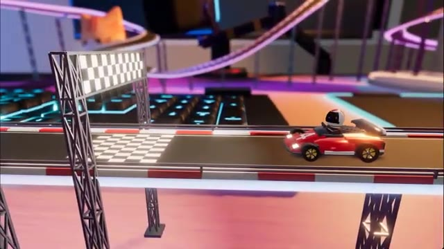
*Démonstration vidéo d'un petit kart rouge sur un circuit de course miniature installé sur un bureau.*

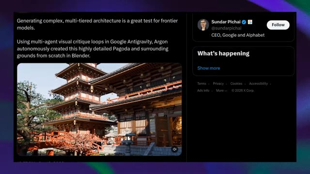
*Publication sur le réseau social X de Sundar Pichai montrant une pagode générée par IA.*

---

### ⏱️ `[00:00:22 - 00:00:57]` | Segment #02

**🔊 Audio (Transcription Intégrale Mot pour Mot en Français) :**
> Argon a reçu la tâche de créer une pagode de style japonais très détaillée et ses environs à partir de zéro dans Blender. Et regardez-moi ça. Nous avons des bâtiments en bois à plusieurs niveaux, des structures de toit complexes, un pont incurvé, des jardins et un environnement détaillé entourant toute la structure. Mais la partie intéressante n'est pas seulement son apparence. Sundar a expliqué qu'Argon a utilisé des boucles de critique visuelle multi-agents à l'intérieur de Google Antigravity pour créer et affiner la scène. En termes simples, cette approche permet aux agents IA d'examiner les résultats visuels, d'identifier les éléments à améliorer et de travailler à travers plusieurs cycles de

**👁️ Analyse Visuelle d'Écran (gemini-3.5-flash-lite) :**
**Interface & Outils** : Navigateur web affichant une publication sur la plateforme X (anciennement Twitter) de Sundar Pichai, CEO de Google and Alphabet, ainsi que des rendus vidéo 3D de Blender.

**Contenu textuel & Code** : Texte du tweet : "Generating complex, multi-tiered architecture is a great test for frontier models. Using multi-agent visual critique loops in Google Antigravity, Argon autonomously created this highly detailed Pagoda and surrounding grounds from scratch in Blender." Nom du profil : "Sundar Pichai @sundarpichai CEO, Google and Alphabet".

**Action / Démonstration** : Défilement de la page X et affichage de plans visuels détaillés du modèle 3D de la pagode japonaise généré par l'IA.

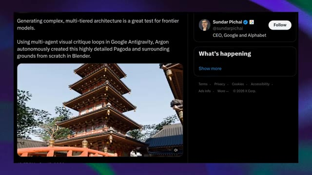
*Capture d'écran d'un tweet de Sundar Pichai sur X (Twitter) présentant une pagode japonaise détaillée créée dans Blender par l'IA Argon.*

*Gros plan sur le rendu visuel détaillé de la pagode japonaise en bois, du pont rouge incurvé, des lanternes en pierre et des jardins.*

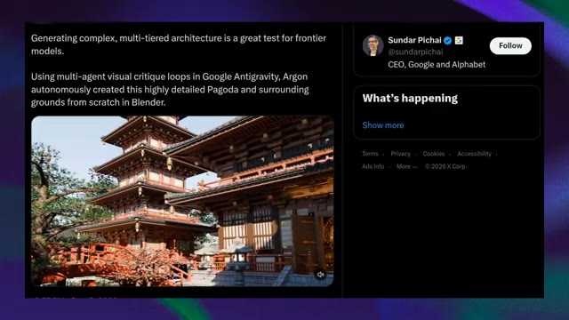
*Vue similaire au tweet de Sundar Pichai montrant le post sur X avec le texte explicatif sur Google Antigravity et les boucles de critique multi-agents.*

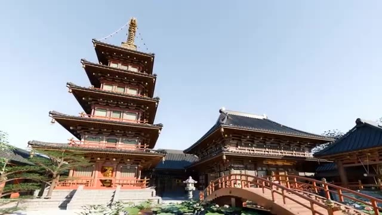
*Vue d'ensemble de la pagode à plusieurs niveaux et du complexe de bâtiments traditionnels japonais sous un ciel dégagé.*

---

### ⏱️ `[00:00:57 - 00:01:28]` | Segment #03

**🔊 Audio (Transcription Intégrale Mot pour Mot en Français) :**
> de raffinement. Et c'est important pour la création 3D, car générer quelque chose qui a l'air bien sous un angle est une chose. Construire un environnement qui se tient à partir de différents points de vue est un défi bien plus grand. Et la Pagode n'est pas le seul projet partagé par Sundar. Dans un autre exemple, Argonne part d'un fichier CAD de pixels bruts et le transforme en une animation de produit 3D complète. Nous parlons d'une animation en vue éclatée du téléphone, de l'éclairage, de la chorégraphie de la caméra et même de l'audio, le tout créé via Blender en utilisant le Blender MCP.

**👁️ Analyse Visuelle d'Écran (gemini-3.5-flash-lite) :**
**Interface & Outils** : Rendu d'animation 3D et modélisation architecturale / produit (Blender).

**Contenu textuel & Code** : Modèle 3D détaillé d'un complexe de temples japonais avec jardins, puis animation technique d'un smartphone montrant ses pièces internes (batterie, modules de caméra, circuits).

**Action / Démonstration** : Démonstration visuelle de la cohérence spatiale d'un environnement 3D sous différents angles, suivie d'une animation 3D de produit (téléphone).

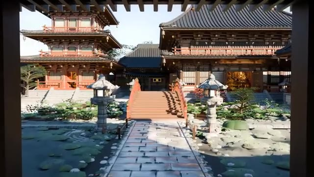
*Vue d'ensemble d'un environnement 3D complexe représentant une pagode japonaise traditionnelle avec un pont et un bassin.*

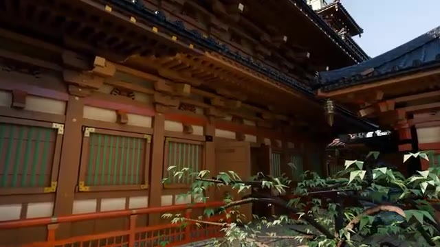
*Gros plan sur l'architecture en bois d'un bâtiment traditionnel japonais, illustrant la précision des détails de modélisation 3D.*

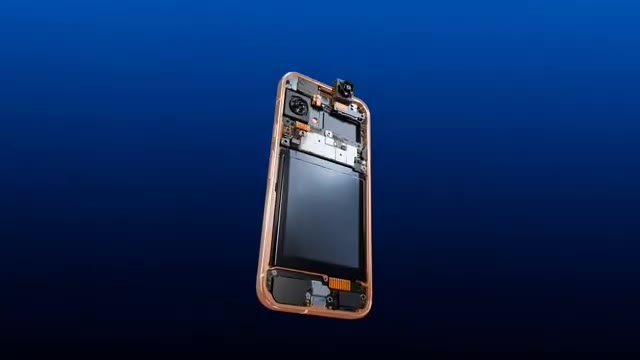
*Animation 3D en vue éclatée d'un smartphone sur fond bleu, montrant ses composants internes.*

---

### ⏱️ `[00:01:28 - 00:02:11]` | Segment #04

**🔊 Audio (Transcription Intégrale Mot pour Mot en Français) :**
> Et voici le détail qui a vraiment retenu mon attention. Selon Sundar, Argon a exécuté 1 000 cycles de boucles itératives, vérifiant ses propres rendus et affinant le code tout au long du processus. Plutôt que de générer la scène une seule fois et de s'arrêter là, il a vérifié à plusieurs reprises le résultat et apporté des améliorations. Sundar a également partagé une animation de typographie cinétique 3D générée entièrement par le code, y compris la musique, sans images pré-enregistrées ni logiciel de montage vidéo traditionnel.

**👁️ Analyse Visuelle d'Écran (gemini-3.5-flash-lite) :**
**Interface & Outils** : Présentation vidéo avec affichage d'éléments graphiques, publications de réseaux sociaux et extraits d'animations générées par IA.

**Contenu textuel & Code** : Texte du titre « Gemini 4 Argon », publication de Sundar Pichai (CEO, Google and Alphabet) avec le texte : « Some great use cases from Googlers building with Gemini 4 Argon. It has a much stronger grasp of coding and multi-step tool use... It ran 1,000 rounds of iterative loops to check its own renders and refine the code along the way. », ainsi que des animations 3D cinétiques.

**Action / Démonstration** : Présentation des capacités de Gemini 4 Argon en matière de génération de code, d'animation 3D et de boucles de rendu itératives.

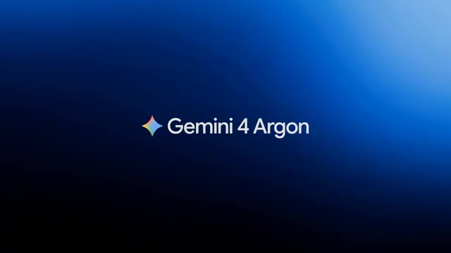
*Écran titre affichant le logo Gemini 4 Argon sur un fond dégradé bleu.*

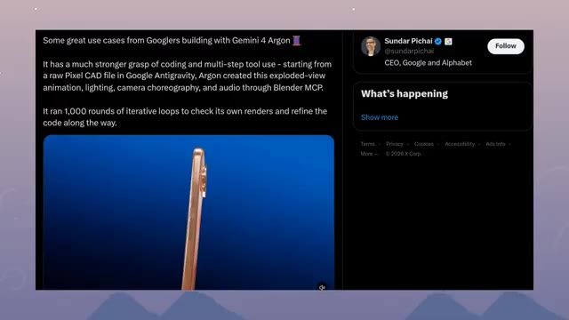
*Publication sur le réseau social X (Twitter) du compte de Sundar Pichai montrant le texte descriptif sur Gemini 4 Argon et un aperçu vidéo.*

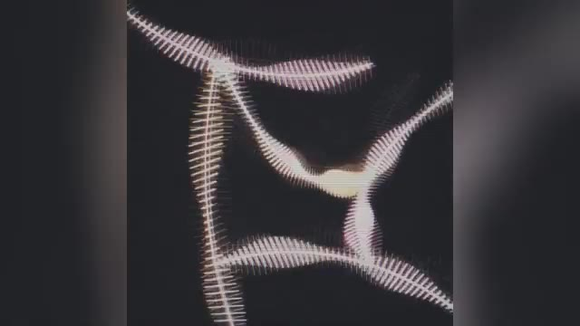
*Animation abstraite en 3D à typographie cinétique générée entièrement par le code.*

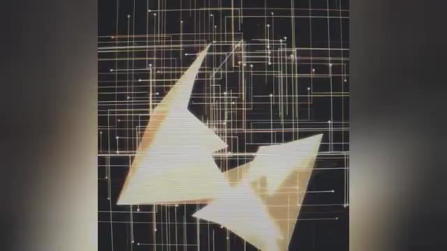
*Animation 3D géométrique avec des formes triangulaires sur fond de grille technologique lumineuse.*

---

### ⏱️ `[00:02:11 - 00:02:31]` | Segment #05

**🔊 Audio (Transcription Intégrale Mot pour Mot en Français) :**
> Et c'est là que les choses deviennent intéressantes. Nous allons au-delà de la simple génération d'une image ou de l'écriture de quelques lignes de code par l'IA. Ces exemples montrent Argon à l'œuvre dans plusieurs parties d'un flux de travail créatif, de la programmation et du design visuel à l'animation et à l'audio. Mais passons un instant aux animations de produits, car le prochain exemple est complètement différent.

**👁️ Analyse Visuelle d'Écran (gemini-3.5-flash-lite) :**
**Interface & Outils** : Interface du réseau social X (Twitter) affichant un tweet publié par le compte de Sundar Pichai.

**Contenu textuel & Code** : Texte du tweet : "Argon generated this 3D kinetic typography entirely in code (including the music) without pre-recorded footage or video editing software. Every frame was drawn by Argon using mathematical algorithms (3D meshes, particle simulations, vector geometry, etc)". Visuel affichant "Gemini 4 Argon" puis la lettre "E" en structure filaire (mesh 3D).

**Action / Démonstration** : Le créateur présente une publication sur X démontrant les capacités de génération typographique 3D entièrement par code de Gemini 4 Argon.

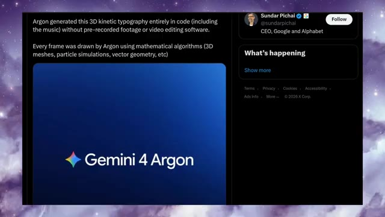
*Capture d'écran d'un tweet de Sundar Pichai montrant une vidéo générée par Gemini 4 Argon avec le logo textuel.*

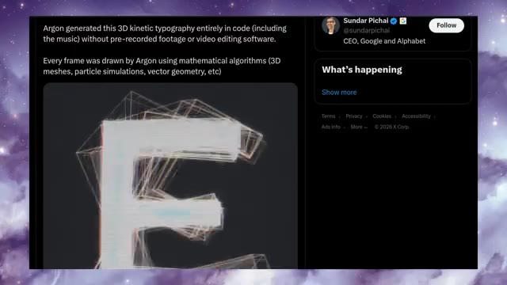
*Affichage du même tweet de Sundar Pichai montrant le rendu en fil de fer 3D d'une lettre (mesh 3D).*

---

### ⏱️ `[00:02:31 - 00:02:55]` | Segment #06

**🔊 Audio (Transcription Intégrale Mot pour Mot en Français) :**
> utilisé Argon pour créer une vidéo d'un pélican faisant du vélo en utilisant quelque chose appelé les épicycles de Fourier. Maintenant, cela peut sembler compliqué, mais l'idée de base est plutôt cool. En combinant des cercles rotatifs se déplaçant à différentes vitesses, vous pouvez tracer des formes étonnamment complexes. Et selon le créateur, Argon a créé la vidéo, tandis que la musique synchronisée a été générée en utilisant Lyria 3.5 à partir d'un prompt écrit par Argon.

**👁️ Analyse Visuelle d'Écran (gemini-3.5-flash-lite) :**
**Interface & Outils** : Navigateur web affichant un réseau social (X / Twitter) avec un lecteur vidéo intégré.

**Contenu textuel & Code** : Texte du tweet : "Argon has this amazing natural understanding of the world... Here's a pelican riding a bike, using fourier epicycles. Video made by Argon. Time-synced Lyria 3.5 music prompted by Argon." Sur l'animation : "N = 10", "error = 16.55%", "21 spinning circles", et des formules mathématiques de Fourier.

**Action / Démonstration** : Affichage d'une publication sur les réseaux sociaux présentant une vidéo d'animation mathématique réalisée par l'outil Argon, suivie d'un gros plan sur l'animation en cours de lecture montrant le tracé par épicycles.

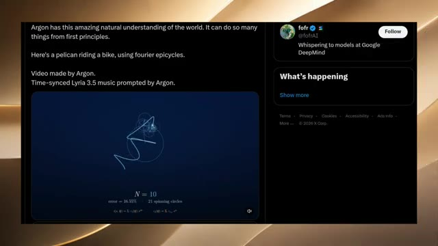
*Capture d'écran d'un tweet de @fofrAI montrant une vidéo générée par Argon avec des cercles épicycles de Fourier.*

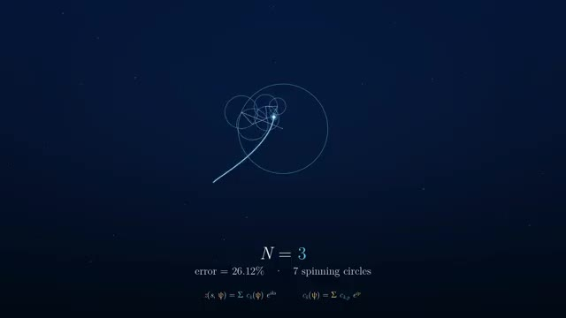
*Gros plan sur l'animation montrant des cercles rotatifs (épicycles de Fourier) avec la formule mathématique et le paramètre N = 3.*

---

### ⏱️ `[00:02:55 - 00:03:13]` | Segment #07

**🔊 Audio (Transcription Intégrale Mot pour Mot en Français) :**
> Donc ce n'est pas simplement une image de pélican. C'est une visualisation mathématique transformée en animation, avec de la musique synchronisée pour l'accompagner. Et je pense que des exemples comme celui-ci montrent une autre facette intéressante d'Argon. Sa capacité à combiner des concepts mathématiques, du code, des visuels et de l'audio en un seul résultat créatif.

**👁️ Analyse Visuelle d'Écran (gemini-3.5-flash-lite) :**
**Interface & Outils** : Interface de visualisation ou de rendu mathématique (style animation de type Manim ou outil Argon) sur fond sombre étoilé.

**Contenu textuel & Code** : Texte « N = 1024 », « error = 0.33% », « 2,049 spinning circles », ainsi que des formules mathématiques en bas de l'écran et un encadré montrant une vue détaillée en incrustation à droite.

**Action / Démonstration** : Affichage d'une animation graphique vectorielle générée par des cercles en rotation basés sur des équations mathématiques complexes.

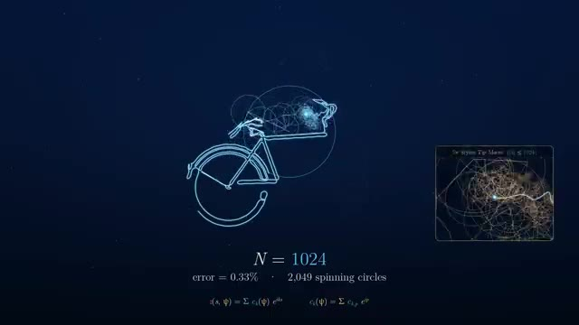
*Visualisation mathématique animée montrant des cercles tournants formant un dessin avec des équations et des paramètres textuels.*

---

### ⏱️ `[00:03:13 - 00:04:11]` | Segment #08

**🔊 Audio (Transcription Intégrale Mot pour Mot en Français) :**
> En fait, Argon a même réalisé sa propre vidéo d'introduction. Et honnêtement, c'est plutôt intéressant à regarder.

**👁️ Analyse Visuelle d'Écran (gemini-3.5-flash-lite) :**
**Interface & Outils** : Interface de lecteur vidéo intégrée à la plateforme X (Twitter) affichant une vidéo d'animation 3D de présentation du modèle Gemini 4 Argon.

**Contenu textuel & Code** : Textes visibles : "Gemini 4 Argon introduction video by Gemini 4 Argon", profil "Harshith" (@HarshithLucky3) avec la mention "AI AI AI -> AGI -> ASI", et le nom "Argon" à côté du chiffre "4".

**Action / Démonstration** : Le créateur présente une vidéo d'introduction générée ou publiée en ligne concernant le modèle "Gemini 4 Argon", montrant des séquences d'animation 3D futuristes (personnage Android, intérieur de véhicule autonome, vue aérienne et graphismes de présentation).

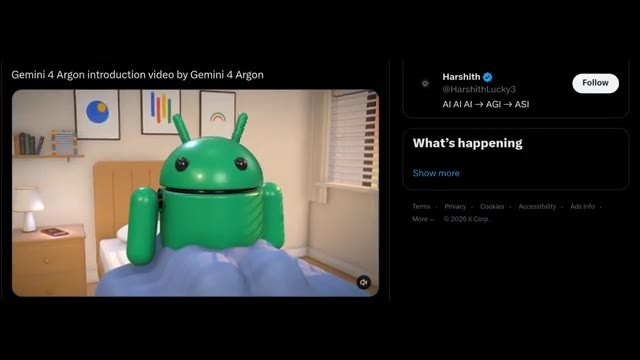
*Extrait vidéo de la publication X montrant un personnage Android vert dans une chambre avec le texte "Gemini 4 Argon introduction video by Gemini 4 Argon" et le profil de Harshith.*

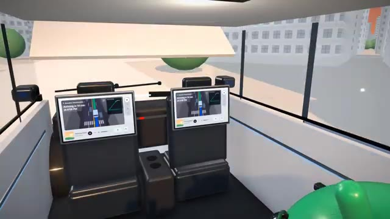
*Vue subjective depuis l'intérieur d'un véhicule ou d'un transport futuriste automatisé avec des écrans de contrôle affichant les trajets et l'arrivée prochaine.*

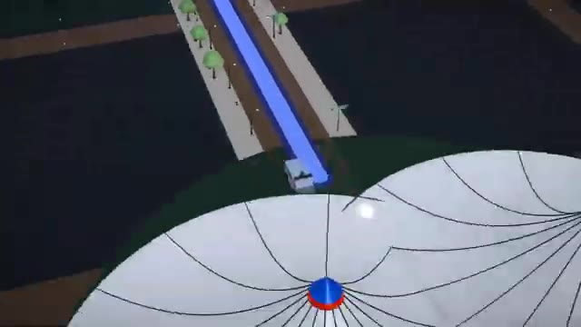
*Vue aérienne stylisée d'une ville ou d'un réseau géométrique avec un canal d'eau et des infrastructures en 3D.*

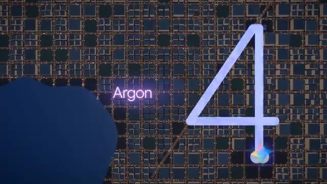
*Animation montrant le chiffre "4" lumineux au-dessus d'une grille urbaine avec le texte "Argon".*

---

### ⏱️ `[00:04:11 - 00:04:29]` | Segment #09

**🔊 Audio (Transcription Intégrale Mot pour Mot en Français) :**
> Mais les démonstrations créatives impressionnantes sont une chose. La question suivante est de savoir à quelle vitesse Argon peut réellement construire quelque chose. Et c'est là que les résultats commencent à devenir vraiment intéressants. Un utilisateur a demandé à Gemini4Argon de créer un château, et selon sa publication, l'environnement 3D a été achevé en moins de 4 minutes. Jetez un œil au résultat.

**👁️ Analyse Visuelle d'Écran (gemini-3.5-flash-lite) :**
**Interface & Outils** : Interface de la plateforme X (anciennement Twitter) affichant des publications de démonstration avec des vidéos intégrées.

**Contenu textuel & Code** : Texte affiché : « Gemini 4 Argon introduction video by Gemini 4 Argon » et sur la deuxième image « asked Gemini 4 Argon for a castle > and it did it under 4 minutes i'ts crazy fast ».

**Action / Démonstration** : Visualisation de publications sur les réseaux sociaux illustrant la génération rapide d'environnements 3D par Gemini 4 Argon.

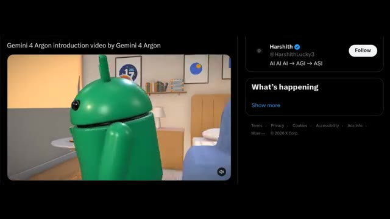
*Capture d'écran montrant une publication sur les réseaux sociaux avec une vidéo de démonstration de Gemini 4 Argon mettant en scène un personnage Android vert dans une pièce.*

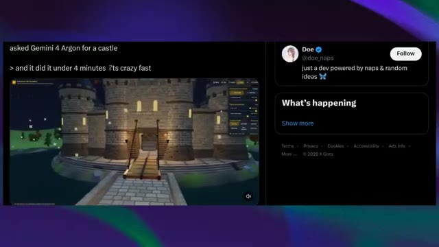
*Capture d'écran montrant une autre publication sur les réseaux sociaux d'un utilisateur affichant le résultat 3D d'un château généré en moins de 4 minutes.*

---

### ⏱️ `[00:04:29 - 00:04:49]` | Segment #10

**🔊 Audio (Transcription Intégrale Mot pour Mot en Français) :**
> Vous avez un grand château avec plusieurs tours, des paysages environnants, des arbres et même un fossé autour de la structure. Et rappelez-vous, ce n'est pas seulement une image plate d'un château, c'est un environnement 3D qui peut être visualisé sous différents angles. Bien sûr, nous ne connaissons pas tous les détails de la configuration, et un seul exemple ne nous dit pas avec quelle constance Argon peut produire des résultats de ce genre.

**👁️ Analyse Visuelle d'Écran (gemini-3.5-flash-lite) :**
**Interface & Outils** : Interface web d'un outil de visualisation ou d'un environnement 3D interactif intitulé « CHÂTEAU DE VALORIA », comprenant un panneau de contrôle à droite pour les paramètres de la forteresse (mecanisms, sun & atmosphere, camera views).

**Contenu textuel & Code** : Textes visibles : « CHÂTEAU DE VALORIA », « FORTRESS MECHANISMS », « SUN & ATMOSPHERE », « CAMERA VIEWS » (avec des options comme Overview, Drawbridge, Courtyard, Royal Keep, Moat Reflection, Head's Eye). Boutons d'éclairage en haut : Dawn, Day, Sunset, Night, Controls.

**Action / Démonstration** : Navigation et exploration interactive d'un environnement 3D de château, changement d'angles de vue de la caméra et modification des conditions d'éclairage (jour/nuit).

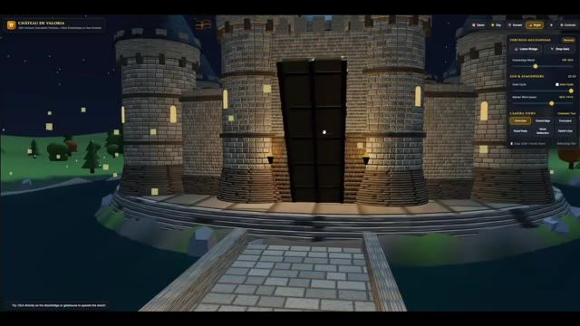
*Vue de face d'un château 3D interactif dans une interface de démonstration nommée Château de Valoria, montrant les tours et le pont-levis.*

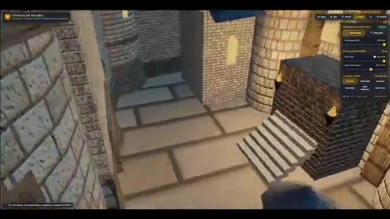
*Vue en plongée à l'intérieur de la cour du château 3D, affichant les murs de pierre et les escaliers depuis un autre angle de caméra.*

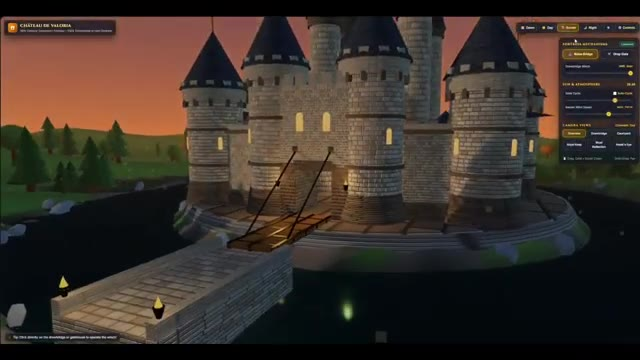
*Vue panoramique extérieure du château 3D au coucher du soleil avec le pont-levis abaissé et les douves remplies d'eau.*

---

### ⏱️ `[00:04:49 - 00:05:09]` | Segment #11

**🔊 Audio (Transcription Intégrale Mot pour Mot en Français) :**
> Mais si ce temps de création rapporté est exact, c'est une démonstration impressionnante de la rapidité avec laquelle l'IA peut assembler une scène 3D. Et maintenant, nous arrivons à la partie que je voulais vraiment vous montrer : comment Argon se compare aux autres modèles. Parce que créer des démos impressionnantes c'est bien, mais comment se comporte-t-il face à Claude Opus 5.5 ?

**👁️ Analyse Visuelle d'Écran (gemini-3.5-flash-lite) :**
**Interface & Outils** : Interface de visualisation et de paramétrage d'une scène 3D interactive, accompagnée d'une capture d'écran du réseau social X (Twitter).

**Contenu textuel & Code** : Textes visibles : "CHÂTEAU DE VALORIA", "FORTRESS MECHANISMS", "Raise Bridge", "Drop Gate", "SUN & ATMOSPHERE", "Time Cycle", "Banner Wind Speed", "CAMERA VIEWS", "Cinematic Tour", et sur le tweet : "asked Gemini 4 Argon for a castle > and it did it under 4 minutes i'ts crazy fast".

**Action / Démonstration** : Rotation et affichage d'une scène de château 3D générée automatiquement, puis présentation d'une publication sur les réseaux sociaux.

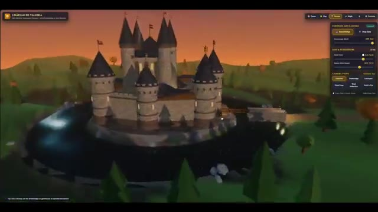
*Visualisation 3D d'un château médiéval (Château de Valoria) généré par IA dans une interface avec panneaux de réglages.*

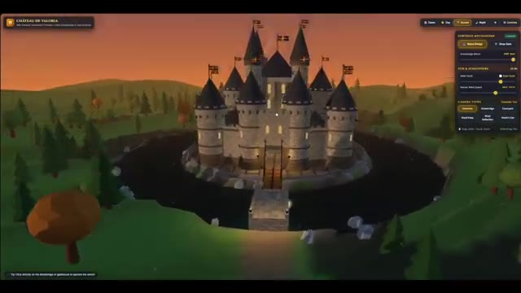
*Vue rapprochée et dynamique de la scène 3D du château avec l'interface de contrôle et d'éclairage.*

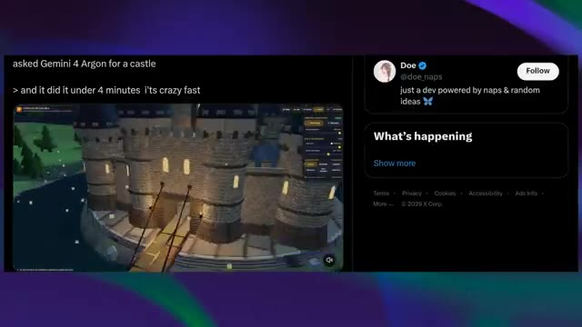
*Capture d'écran d'un tweet montrant la démo du château généré par Gemini 4 Argon en moins de 4 minutes.*

---

### ⏱️ `[00:05:09 - 00:05:28]` | Segment #12

**🔊 Audio (Transcription Intégrale Mot pour Mot en Français) :**
> Commençons par un test impliquant un environnement de train spatial en 3D. Selon le créateur, les deux modèles ont reçu le même prompt. Gemini 4 Argon a terminé en 4 minutes et 20 secondes, pour un coût de 3,40 dollars. Claude Opus 5.5 a pris 1 heure et 53 minutes et a coûté 23,46 dollars.

**👁️ Analyse Visuelle d'Écran (gemini-3.5-flash-lite) :**
**Interface & Outils** : Navigateur web affichant une publication sur le réseau social X (anciennement Twitter) de l'utilisateur @EnvoiDev.

**Contenu textuel & Code** : Texte du tweet : "4 minutes. $3.40. That's all Gemini needed 🤯. Same prompt: Opus took 1h 53m and cost $23.46. Gemini took 4m 20s and cost $3.40. That's 26x faster and 7x cheaper 🔐. Did it beat Opus? No. Opus is still ahead on detail: the volumetric clouds, the mechanics on the locomotive, the camera work. But the gap is way smaller than the price gap. Gemini still pulled off the station, the planets and the lightning, in less time than it takes to make a coffee ☕. When you need something good in minutes, not perfect in 2 hours, this is nuts. Watch them side by side and tell me: is Opus worth 7x the price here? 👀". En bas, une vidéo comparative labellisée "Gemini" vs "Claude Opus 5.5" montrant l'environnement 3D avec un train spatial.

**Action / Démonstration** : Présentation d'un tweet comparatif détaillé avec statistiques de temps de calcul et de coûts entre deux modèles d'IA générative.

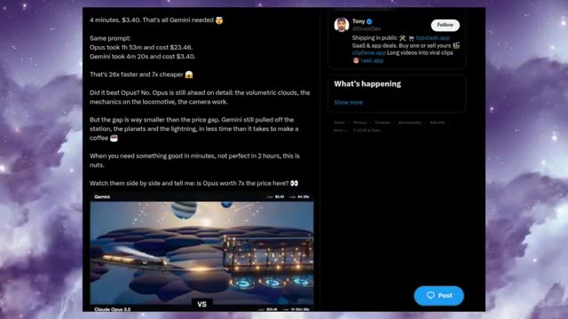
*Capture d'écran d'un tweet comparant les performances et les coûts entre Gemini et Claude Opus sur un environnement de train spatial 3D.*

---

### ⏱️ `[00:05:28 - 00:05:46]` | Segment #13

**🔊 Audio (Transcription Intégrale Mot pour Mot en Français) :**
> Cela signifie qu'Argon était environ 26 fois plus rapide et près de 7 fois moins cher dans ce test particulier. Mais avant de supposer qu'Argon a tout gagné, il y a un piège important. Le créateur a en fait donné l'avantage à Opus en matière de détails visuels, mentionnant spécifiquement ses nuages volumétriques, la mécanique de la locomotive et le travail de la caméra.

**👁️ Analyse Visuelle d'Écran (gemini-3.5-flash-lite) :**
**Interface & Outils** : Interface de Twitter/X affichant un tweet avec du texte comparatif et une vidéo intégrée de test d'IA.

**Contenu textuel & Code** : Texte du tweet : "4 minutes. $3.40. That's all Gemini needed 🤯 Same prompt: Opus took 1h 53m and cost $23.46. Gemini took 4m 20s and cost $3.40. That's 26x faster and 7x cheaper 🤯 Did it beat Opus? No. Opus is still ahead on detail: the volumetric clouds, the mechanics on the locomotive, the camera work." Comparatif chiffré des coûts et durées pour chaque modèle (Gemini : 3,40 $ en 4m 20s / Claude Opus 5.5 : 23,46 $ en 1h 52m 56s).

**Action / Démonstration** : Défilement ou affichage d'une publication sur les réseaux sociaux comparant les performances, les coûts et le rendu visuel de deux modèles d'IA générative.

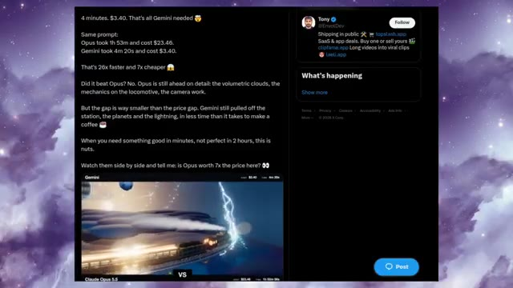
*Capture d'écran d'un tweet de Tony montrant le comparatif entre Gemini et Claude Opus 5.5, avec une vidéo côte à côte en bas.*

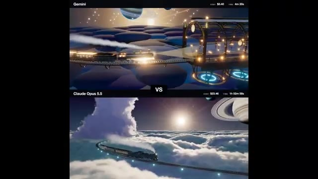
*Comparaison vidéo côte à côte en plein écran entre Gemini (en haut) et Claude Opus 5.5 (en bas) montrant les décors célestes et les trains.*

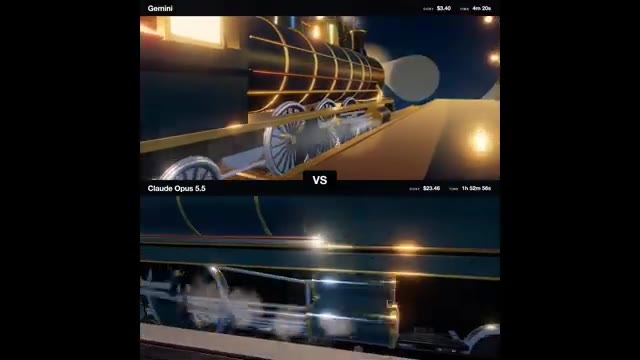
*Gros plan sur la comparaison vidéo côte à côte se concentrant sur la mécanique des roues et des locomotives de Gemini et Claude Opus 5.5.*

---

### ⏱️ `[00:05:46 - 00:06:04]` | Segment #14

**🔊 Audio (Transcription Intégrale Mot pour Mot en Français) :**
> Argon a quand même créé la station, les planètes et les éclairs, mais Opus a produit un résultat plus détaillé. Le compromis est donc assez clair ici. Si vous voulez les détails visuels les plus poussés et que vous avez plus de temps et d'argent à y consacrer, Opus mérite peut-être d'être envisagé. Mais si vous avez besoin d'un résultat solide rapidement et à moindre coût, Argon apparaît comme une alternative séduisante.

**👁️ Analyse Visuelle d'Écran (gemini-3.5-flash-lite) :**
**Interface & Outils** : Interface de comparaison vidéo split-screen ("Gemini" / "Claude Opus 5.5") avec affichage des coûts et du temps de rendu en haut de chaque écran ("Cost $3.40", "Time 4m 20s" vs "Cost $23.46", "Time 1h 52m 56s").

**Contenu textuel & Code** : Vues comparatives de scènes de train futuriste/spatial générées par IA avec des métriques de performance et de coût.

**Action / Démonstration** : Visualisation comparative côte à côte (split-screen) des rendus générés par deux modèles d'IA différents.

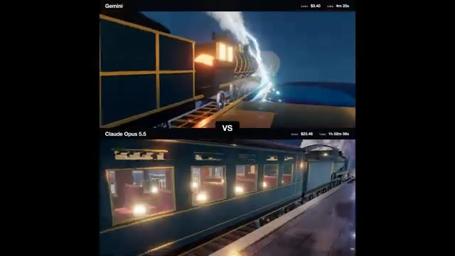
*Comparaison vidéo split-screen montrant en haut Gemini (Argon) et en bas Claude Opus 5.5, avec un train près d'un éclair et d'une station.*

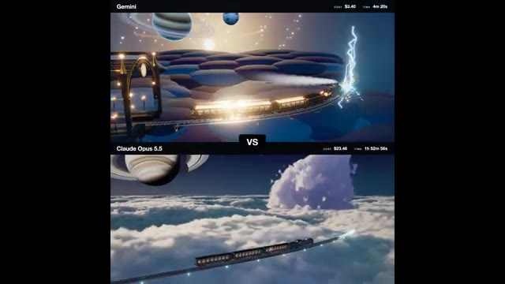
*Comparaison vidéo split-screen montrant en haut Gemini (Argon) avec des planètes et un éclair, et en bas Claude Opus 5.5 avec un train au-dessus des nuages et des planètes.*

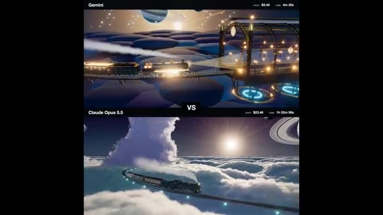
*Comparaison vidéo split-screen montrant en haut Gemini (Argon) avec une station spatiale et des planètes, et en bas Claude Opus 5.5 avec un train serpentant au-dessus d'une mer de nuages sous un soleil radieux et des anneaux de Saturne.*

---

### ⏱️ `[00:06:04 - 00:06:27]` | Segment #15

**🔊 Audio (Transcription Intégrale Mot pour Mot en Français) :**
> Et ce n'est pas la seule comparaison qui vaille le détour. Un autre créateur a testé Argon face à Opus 5.5 en utilisant le même prompt avec les réglages de raisonnement les plus élevés disponibles pour les deux modèles. Selon ce créateur, les résultats étaient presque identiques, mais regardez le temps et le coût. Opus a pris 15 minutes et coûté 8,20 dollars, tandis qu'Argon a terminé en 13 minutes pour seulement 1,20 dollar.

**👁️ Analyse Visuelle d'Écran (gemini-3.5-flash-lite) :**
**Interface & Outils** : Interface du réseau social X (anciennement Twitter) affichant un tweet détaillé avec texte explicatif, liens et images comparatives de génération de modèles d'IA.

**Contenu textuel & Code** : Texte du tweet de @notjazii : "tested both models with same prompt at highest reasoning available but results came out almost the same. > opus took 15 mins and cost $8.2 via claude code cli > argon took 13 mins and cost $1.2 via devin cli. really impressed by how well argon did, it came pretty close to opus 5.5 for way less money. running 3d tests now, you can check all the tests i ran on argon here: gemini-4-argon.vercel.app. what do you think, did argon cook or nah?" Légendes des images : "Gemini 4 Argon (High)" et "Opus 5.5 (High)".

**Action / Démonstration** : Affichage des résultats comparatifs visuels et textuels d'un test de performance entre deux modèles d'IA (Gemini 4 Argon et Opus 5.5).

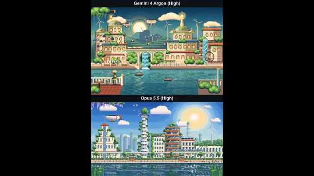
*Comparaison côte à côte des résultats générés par Gemini 4 Argon (High) et Opus 5.5 (High) représentant des paysages urbains futuristes en pixel art.*

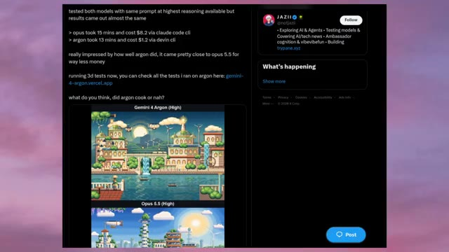
*Publication sur le réseau social X par @notjazii montrant le comparatif des performances, du temps d'exécution et des coûts entre Opus et Argon, accompagné des images générées.*

---

### ⏱️ `[00:06:27 - 00:07:04]` | Segment #16

**🔊 Audio (Transcription Intégrale Mot pour Mot en Français) :**
> Donc Argon était légèrement plus rapide et le coût était environ 85 % plus bas. C'est une différence assez significative si vous construisez régulièrement des environnements 3D et expérimentez différentes idées. Bien sûr, ce sont des tests individuels, pas la preuve qu'Argon égalera toujours Opus. Les résultats peuvent varier selon la tâche, la configuration et la qualité visée. Néanmoins, lorsque deux résultats semblent comparables à la personne qui effectue le test, dépenser beaucoup moins pour y arriver est un réel avantage. Et enfin, nous avons une dernière comparaison, cette fois en amenant GPT-6 Astra dans le mélange aux côtés de Claude Opus 5.5 et Gemini 4.

**👁️ Analyse Visuelle d'Écran (gemini-3.5-flash-lite) :**
**Interface & Outils** : Interface de test et de comparaison de modèles d'IA générative 3D (comparatifs vidéo et interface de publication du réseau social X).

**Contenu textuel & Code** : Textes visibles : "Gemini 4 Argon (High)", "Opus 5.5 (High)", "Gemini 4 Argon", "Opus 5.5 Medium (Routing)", "Gemini 4 Argon vs. Claude Opus 5.5 vs. GPT-6 Astra", ">Here Gemini 4 Argon clearly won", "Pranav Reddy @AI_Screening", "Training, testing & serving AI models.", "What's happening".

**Action / Démonstration** : Le présentateur compare visuellement les performances, la vitesse et le rendu d'environnements 3D générés par différents modèles d'IA (Gemini, Claude, GPT), puis présente un tweet comparatif intégrant un troisième modèle.

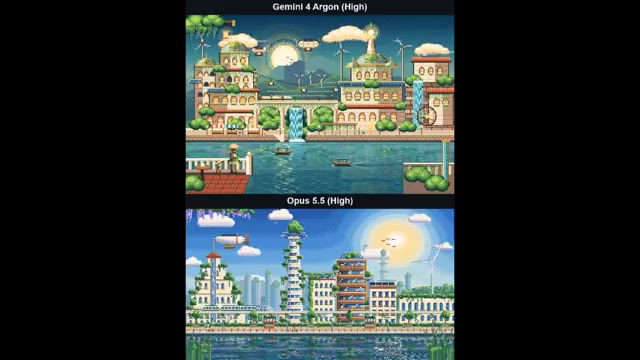
*Comparaison côte à côte de deux environnements 3D générés par Gemini 4 Argon (High) et Opus 5.5 (High).*

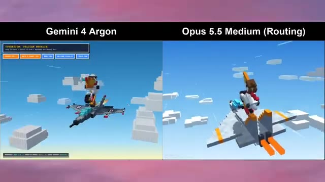
*Comparaison vidéo de scènes 3D en voxel affichant Gemini 4 Argon à gauche et Opus 5.5 Medium (Routing) à droite.*

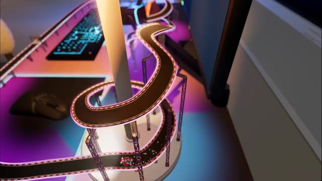
*Rendu 3D en plongée d'un circuit de course miniature lumineux installé sur un bureau avec un clavier rétroéclairé.*

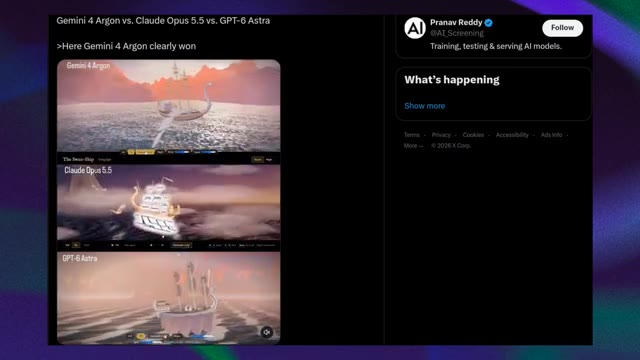
*Capture d'écran du réseau social X montrant une publication comparative à trois modèles (Gemini 4 Argon, Claude Opus 5.5 et GPT-6 Astra).*

---

### ⏱️ `[00:07:04 - 00:07:34]` | Segment #17

**🔊 Audio (Transcription Intégrale Mot pour Mot en Français) :**
> Argon. La tâche consistait à créer un navire cygne 3D interactif naviguant sur l'eau. Examinons les résultats. La version d'Argon présente un navire en forme de cygne stylisé, un arrière-plan de coucher de soleil et des commandes interactives pour naviguer, voler et changer la vue de la caméra. Opus 5.5 produit également un navire cygne, bien que certaines parties de son résultat semblent moins soignées dans la vidéo. Ensuite, il y a GPT-6 Astra, qui génère un autre navire détaillé avec plusieurs voiles et ses propres commandes interactives.

**👁️ Analyse Visuelle d'Écran (gemini-3.5-flash-lite) :**
**Interface & Outils** : Interface du réseau social X (anciennement Twitter) affichant un comparatif vidéo de démonstration de 3 modèles d'IA.

**Contenu textuel & Code** : Texte du tweet : « Gemini 4 Argon vs. Claude Opus 5.5 vs. GPT-6 Astra > Here Gemini 4 Argon clearly won ». Étiquettes vidéo : « Gemini 4 Argon », « Claude Opus 5.5 », « GPT-6 Astra », « The Swan Ship ».

**Action / Démonstration** : Comparaison visuelle des performances de génération et de rendu 3D interactif entre trois modèles d'intelligence artificielle différents.

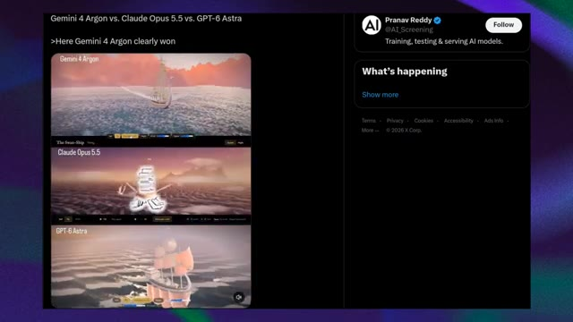
*Capture d'écran d'un tweet comparant les résultats de Gemini 4 Argon, Claude Opus 5.5 et GPT-6 Astra sur le défi du navire cygne.*

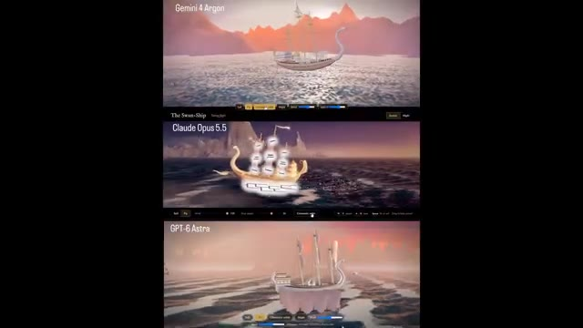
*Comparaison vidéo côte à côte des trois modèles d'IA générant et contrôlant le navire cygne interactif.*

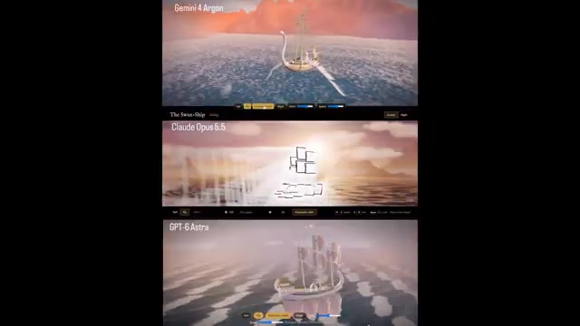
*Poursuite de la démonstration visuelle comparant le rendu des trois IA avec des interfaces de contrôle interactives.*

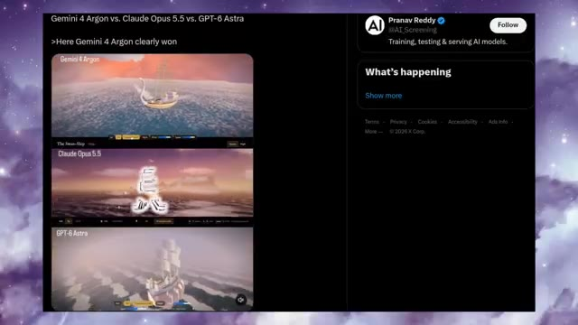
*Retour à la vue globale du tweet avec le comparatif vidéo des trois modèles d'IA.*

---

### ⏱️ `[00:07:34 - 00:07:53]` | Segment #18

**🔊 Audio (Transcription Intégrale Mot pour Mot en Français) :**
> Le post original déclare qu'Argon est le vainqueur, mais je prendrais cette conclusion avec un peu de recul. Une comparaison visuelle comme celle-ci est utile, mais il faudrait tester la fonctionnalité, la cohérence et la qualité globale dans des conditions contrôlées avant de déclarer un vainqueur absolu. Malgré tout, ces exemples montrent pourquoi Argon mérite que l'on s'y intéresse.

**👁️ Analyse Visuelle d'Écran (gemini-3.5-flash-lite) :**
**Interface & Outils** : Interface de comparaison vidéo comparative verticale à trois volets affichant simultanément les rendus de différents modèles d'IA.

**Contenu textuel & Code** : Noms des modèles affichés en surimpression : "Gemini 4 Argon", "The Swan-Ship", "Claude Opus 5.5", "GPT-6 Astra" ainsi que diverses barres de contrôle et curseurs de lecture en bas de chaque écran.

**Action / Démonstration** : Lecture simultanée de trois clips vidéo générés par IA montrant des variations de rendu 3D d'un bateau sur l'eau.

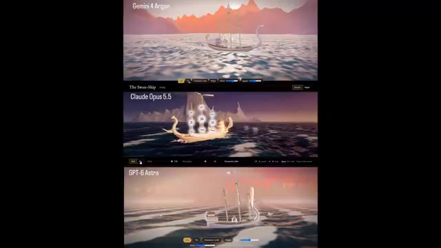
*Comparaison vidéo en trois écrans divisés montrant les modèles Gemini 4 Argon, Claude Opus 5.5 et GPT-6 Astra avec un bateau naviguant sur l'eau.*

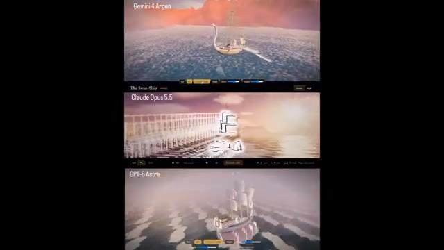
*Poursuite de la comparaison vidéo sur trois écrans divisés montrant l'évolution de la navigation du bateau avec des artefacts visuels sur le modèle central.*

---

### ⏱️ `[00:07:53 - 00:08:20]` | Segment #19

**🔊 Audio (Transcription Intégrale Mot pour Mot en Français) :**
> Nous le voyons s'attaquer à différents types de tâches créatives, allant d'environnements détaillés et d'animations mathématiques à des expériences 3D interactives. Et lorsque nous examinons les comparaisons, son avantage potentiel devient encore plus clair. Il ne s'agit pas nécessairement de battre chaque modèle concurrent sur chaque tâche. Il s'agit de produire des résultats utiles rapidement, et dans certains cas, à un coût bien inférieur. Alors, Gemini 4 Argon est-il le nouveau roi des expériences 3D générées par IA ?

**👁️ Analyse Visuelle d'Écran (gemini-3.5-flash-lite) :**
**Interface & Outils** : Interface de présentation multi-fenêtres et interface épurée de type barre de recherche avec croquis interactif.

**Contenu textuel & Code** : Éléments visibles : environnements 3D architecturaux (temple), animations mathématiques avec cercles concentriques et valeurs de N, comparatifs de modèles (Claude Opus 5.5, Gemini 4 Argon, GPT-4o), et un croquis de cerf-volant dans un sélecteur d'interface.

**Action / Démonstration** : Démonstration visuelle comparative de différentes capacités de génération 3D par IA à travers divers cas d'usage (environnements, animations, objets interactifs).

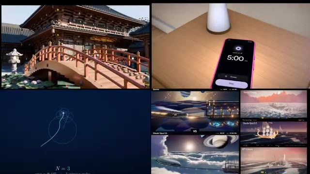
*Écran partagé présentant diverses démonstrations d'expériences 3D générées par IA, incluant un temple japonais, une interface mobile avec un minuteur, des animations géométriques et des comparatifs visuels de modèles.*

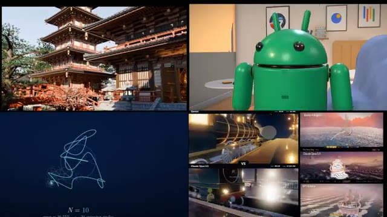
*Écran partagé affichant d'autres exemples de rendus 3D, dont un personnage robot vert, un train circulant sur des rails et des comparaisons de modèles d'IA sur plusieurs fenêtres.*

*Écran partagé montrant des animations 3D complexes, un avatar robot dans un environnement intérieur, ainsi que des comparaisons de scènes de science-fiction entre différents modèles.*

*Gros plan sur une interface sombre avec une icône centrale représentant un croquis de cerf-volant et une barre de recherche semi-transparente mentionnant Gemini.*

---

### ⏱️ `[00:08:20 - 00:08:40]` | Segment #20

**🔊 Audio (Transcription Intégrale Mot pour Mot en Français) :**
> Je pense qu'il est trop tôt pour l'affirmer en se basant sur une poignée de tests communautaires, mais les différences de vitesse et de coût que nous avons observées sont certainement intéressantes, et les exemples créatifs nous donnent de nombreuses raisons de continuer à regarder. Maintenant, je veux vous entendre. Choisiriez-vous Argon pour sa vitesse et son coût inférieur, ou paieriez-vous toujours plus cher et attendriez-vous plus longtemps pour un modèle comme Opus 5.5 ?

**👁️ Analyse Visuelle d'Écran (gemini-3.5-flash-lite) :**
**Interface & Outils** : Présentation vidéo comparative illustrant des exemples créatifs et techniques d'analyses par IA.

**Contenu textuel & Code** : Graphiques techniques, flux de données, tracés vectoriels et simulations scientifiques.

**Action / Démonstration** : Démonstration visuelle d'exemples d'applications de modèles d'intelligence artificielle.

*Comparatif visuel d'un cerf-volant et de son analyse de flux aérodynamique par IA.*

*Écran divisé montrant des vagues sur l'océan à gauche et un suivi de trajectoire d'oiseaux à droite.*

*Visualisation scientifique de données orbitales et astronomiques en deux panneaux graphiques.*

---

### ⏱️ `[00:08:40 - 00:08:51]` | Segment #21

**🔊 Audio (Transcription Intégrale Mot pour Mot en Français) :**
> Dites-le-moi dans les commentaires. Si vous avez apprécié ce rapport de recherche, cliquez sur le bouton J'aime et abonnez-vous à Pursuing AI pour plus d'expériences sur l'intelligence artificielle, de comparatifs de modèles et des derniers développements. Je vous vois dans le prochain.

**👁️ Analyse Visuelle d'Écran (gemini-3.5-flash-lite) :**
**Interface & Outils** : Écran de fin / carte de chaîne YouTube avec animation graphique.

**Contenu textuel & Code** : Visuel d'un cerveau relié à une puce électronique portant la mention 'PAI' à l'intérieur d'un cercle néon bleu, le texte 'The Research Report', et un encadré interactif avec un bouton 'Like' (pouce bleu), un bouton 'Subscribed' (rouge) et une icône de cloche cliquée.

**Action / Démonstration** : Affichage de l'écran de conclusion de la vidéo invitant le spectateur à s'abonner et à interagir.

*Écran de fin de vidéo affichant le logo de la chaîne Pursuing AI, le texte 'The Research Report' et des boutons d'interaction YouTube (J'aime, Abonné, Cloche).*

---
