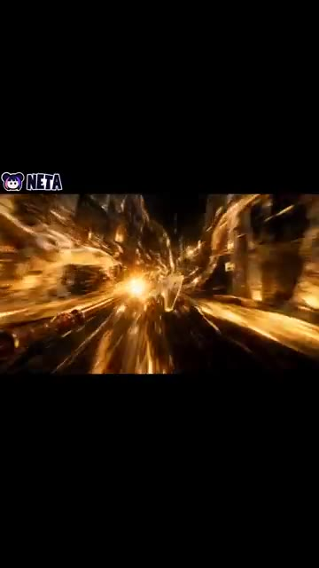
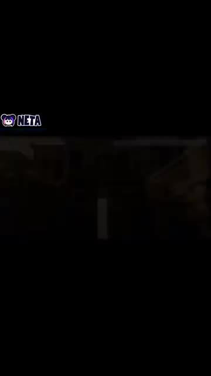
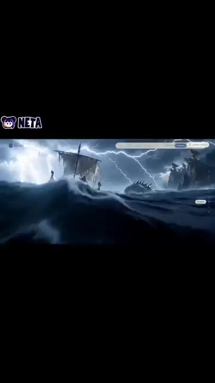
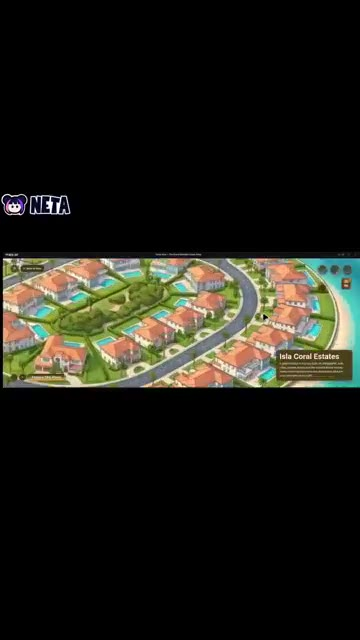
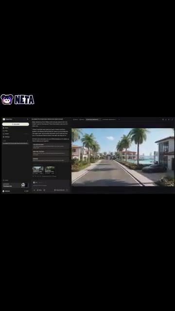
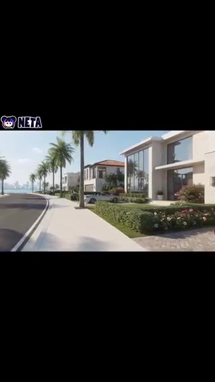
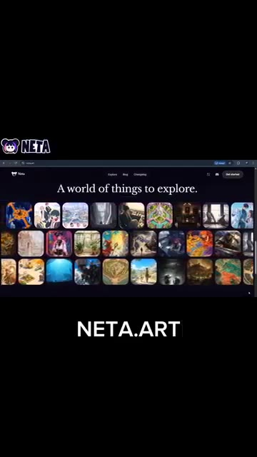

# 🎬 Cette IA vous permet de marcher dans votre propre monde imaginaire 🤯

> **Chaîne** : [Pursuing AI](https://www.youtube.com/@PursuingAi)  
> **Titre original** : `This AI Lets You Walk Through Your Own Imaginary World 🤯`  
> **Lien YouTube** : [https://www.youtube.com/watch?v=AcMbVwwsR44](https://www.youtube.com/watch?v=AcMbVwwsR44)  
> **Date de publication** : 2026-10-19  
> **Durée** : 00m 48s (`48s`)  
> **Identifiant vidéo** : `AcMbVwwsR44`  
> **Fiche Web Interactive** : [2026-10-19_YT-AcMbVwwsR44_Cette IA vous permet de marcher dans votre propre monde imaginaire 🤯_by-whisper-v3-large-turbo+gemini-3.5-flash-lite.html](2026-10-19_YT-AcMbVwwsR44_Cette IA vous permet de marcher dans votre propre monde imaginaire 🤯_by-whisper-v3-large-turbo+gemini-3.5-flash-lite.html)  
> **Captures de démonstration clés** : `7 captures réelles (anti-talking-head)`  
> **Modèles utilisés** : Audio: `large-v3-turbo` (Faster-Whisper int8 VPS) | Vision: `gemini-3.5-flash-lite` (Google AI Studio API)  

---

## 📌 Synthèse Exécutive & Outils

### 📌 Résumé
La vidéo de *Pursuing AI* met en lumière une avancée majeure dans la génération de contenu visuel par intelligence artificielle : la transition d'une simple génération d'images ou de clips isolés vers la création de mondes immersifs interconnectés. L'outil central présenté, Netta Studio, permet aux créateurs de s'affranchir du simple plan fixe pour concevoir des univers fictionnels complets, dotés de leurs propres environnements, personnages et cartes géographiques interactives. Cette approche révolutionne le prototypage visuel et la construction d'univers (*worldbuilding*) en permettant de lier visuellement des scènes disparates au sein d'un même écosystème cohérent.

Sur le plan méthodologique, le processus créatif exposé suit un tunnel de production linéaire mais hautement automatisé : l'incubation d'une vision textuelle initiale, la génération d'environnements fantastiques texturés, l'agencement spatial via une carte du monde globale, et enfin l'incarnation visuelle. Grâce à des mouvements de caméra en vue à la première personne (POV), l'IA simule la déambulation de l'utilisateur à l'intérieur même de sa création. Cette technique transforme un concept abstrait en une expérience sensorielle navigable et partageable, ouvrant des perspectives inédites pour les réalisateurs, les concepteurs de jeux vidéo et les créateurs de contenu en quête d'immersion totale.

Pour les créateurs de vidéo, ce workflow représente un gain de temps et de ressources considérable dans les phases de pré-production et de recherche visuelle. En éliminant le besoin de modélisation 3D complexe ou de moteurs de jeu lourds, ces outils démocratisent la réalisation de décors oniriques et de plans subjectifs complexes. C'est l'émergence d'une nouvelle ère où la narration visuelle ne se contente plus de raconter une histoire, mais invite le spectateur (ou le créateur) à explorer physiquement l'espace mental dont elle est issue.

### 🛠️ Outils, Modèles & Logiciels Présentés
* **Netta Studio** : Plateforme centrale de génération de mondes imaginaires, permettant de concevoir des environnements interconnectés, d'utiliser une carte du monde interactive et de produire des vidéos en vue subjective.
* **Seedance 2.5** : Modèle ou solution technologique mentionné dans l'écosystème global de création vidéo par IA, participant à la fluidité et au dynamisme des mouvements de caméra.
* **Kling 3.0** : Outil de pointe pour la génération de vidéo par IA, utilisé pour insuffler du réalisme et de la cinématique dans les séquences animées.
* **Midjourney** : Référence incontournable de la génération d'images fixes par IA, souvent mobilisée en amont pour le design conceptuel et texturé des environnements fantastiques.

### 🔑 Points Clés & Enseignements Stratégiques
* **Évolution du paradigme créatif** : Le passage de la génération de plans uniques à la conception d'un écosystème visuel global et interconnecté redéfinit le *worldbuilding* moderne.
* **Structuration par la carte du monde** : L'utilisation d'une interface cartographique permet de lier logiquement différents lieux fantastiques, assurant une cohérence spatiale indispensable à l'immersion.
* **Puissance du POV (Vue subjective)** : Générer des vidéos à la première personne simule la marche, transformant le spectateur passif en un explorateur actif de l'univers virtuel.
* **Industrialisation de l'imaginaire** : Le workflow réduit drastiquement la friction entre une idée conceptuelle abstraite et un rendu visuel exploitable en production.
* **Démocratisation des décors complexes** : Plus besoin de compétences avancées en modélisation 3D ou en game design pour faire naître des forêts lumineuses et des royaumes mystérieux.
* **Optimisation de la pré-production** : Cet outil s'avère stratégique pour les réalisateurs cherchant à prototyper rapidement des environnements de films fantastiques avant le tournage.
* **Cohérence stylistique** : Le défi majeur réside dans le maintien d'une identité visuelle forte entre les différents environnements générés par l'IA sur une même carte.
* **Narration expérientielle** : Les créateurs de contenu peuvent désormais exploiter la dimension spatiale pour dynamiser leurs récits et capter l'attention d'un public friand d'immersion.
* **Accessibilité web** : L'intégration de ces technologies via des interfaces web (comme *netta.art*) abaisse la barrière à l'entrée matérielle pour les créateurs indépendants.
* **Synergie des outils multimodaux** : Combiner des phases de design d'environnement (type Midjourney/Netta) et d'animation vidéo (type Kling/Seedance) garantit des résultats à la pointe du réalisme.
* **Gestion des transitions spatiales** : Anticiper la manière dont les lieux se connectent sur la carte évite les ruptures de ton visuelles lors des déplacements en POV.
* **Exploitation du partage social** : La capacité à exporter et partager ces mondes explorables constitue un levier marketing puissant pour fédérer une communauté autour d'un univers fictionnel.

---

## ⏱️ Chronologie & Transcription Complète Audio & Visuelle (Mot pour Mot)

### ⏱️ `[00:00:00 - 00:00:21]` | Segment #01

**🔊 Audio (Transcription Intégrale Mot pour Mot en Français) :**
> Il y a enfin une IA qui vous permet de donner vie à vos mondes imaginaires et d'y pénétrer pour de vrai. Elle s'appelle Netta Studio, et voici comment elle fonctionne. Vous commencez avec une idée, et Netta Studio la transforme en un monde rempli de lieux, de personnages et d'environnements uniques. Imaginez des forêts lumineuses, des royaumes mystérieux et des paysages gigantesques tout droit sortis d'un film fantastique.

**👁️ Analyse Visuelle d'Écran (gemini-3.5-flash-lite) :**
**Interface & Outils** : Démonstration de l'outil Netta Studio avec logo en haut à gauche affichant "NETTA".

**Contenu textuel & Code** : Visuels de mondes imaginaires générés par intelligence artificielle avec le logo de la marque "NETTA".

**Action / Démonstration** : Présentation dynamique de séquences vidéo générées par l'IA illustrant les mondes fantastiques créés.

*Rendu visuel d'un monde fantastique généré par Netta Studio avec un mouvement de caméra immersif rapide.*

*Affichage d'un paysage ou d'un environnement sombre généré par l'outil Netta Studio.*

---

### ⏱️ `[00:00:22 - 00:00:44]` | Segment #02

**🔊 Audio (Transcription Intégrale Mot pour Mot en Français) :**
> Mais cela ne s'arrête pas à la génération de scènes individuelles. Avec une fonctionnalité de carte du monde, vous pouvez rassembler vos lieux et voir comment tout votre monde se connecte. Et vient ensuite la partie la plus cool, vous pouvez générer des vidéos en vue à la première personne (POV) et faire l'expérience de votre monde comme si vous y marchiez réellement. Votre imagination passe d'une simple idée à un monde que vous pouvez voir, explorer et partager.

**👁️ Analyse Visuelle d'Écran (gemini-3.5-flash-lite) :**
**Interface & Outils** : Application de génération vidéo par IA dotée d'une fonction de carte du monde et d'un mode de visualisation en première personne (POV).

**Contenu textuel & Code** : Texte affiché dans l'interface détaillant la génération de scènes interconnectées et le rendu d'un quartier résidentiel de luxe avec des maisons dotées de piscines et de palmiers ('Isla Coral Estates').

**Action / Démonstration** : Navigation à travers une carte interactive montrant des emplacements connectés, puis transition vers une vue subjective (POV) simulant une promenade virtuelle dans le monde généré par IA.

*Scène maritime nocturne générée avec des éclairs et un navire naviguant sur une mer agitée.*

*Vue aérienne ou topographique d'un lotissement résidentiel côtier nommé 'Isla Coral Estates'.*

*Interface de l'outil montrant un panneau latéral avec des prompts textuels et un aperçu vidéo en POV d'une rue bordée de palmiers.*

*Vidéo en vue subjective (première personne) simulant une marche le long d'une rue résidentielle bordée de luxueuses villas et de palmiers.*

---

### ⏱️ `[00:00:44 - 00:00:48]` | Segment #03

**🔊 Audio (Transcription Intégrale Mot pour Mot en Français) :**
> Vous voulez créer le vôtre ? Allez voir Netta Studio sur netta.art.

**👁️ Analyse Visuelle d'Écran (gemini-3.5-flash-lite) :**
**Interface & Outils** : Navigateur web affichant le site Netta Studio (netta.art) avec le logo NETA en haut à gauche et un bandeau de navigation supérieur.

**Contenu textuel & Code** : Texte principal : « A world of things to explore. ». Grille de vignettes illustrant diverses créations artistiques et visuelles générées par intelligence artificielle. Texte ajouté en surimpression en bas : « NETA.ART ».

**Action / Démonstration** : Présentation de la plateforme web Netta Studio et de sa galerie d'œuvres artistiques créées par IA.

*Page d'accueil du site web Netta Studio (netta.art) affichant une galerie d'images générées par IA sous le titre « A world of things to explore ».*

---
