# 🎬 J'ai créé un monde ouvert entier avec l'IA… 🤯

> **Chaîne** : [Pursuing AI](https://www.youtube.com/@PursuingAi)  
> **Titre original** : `I Built an Entire Open World With AI… 🤯`  
> **Lien YouTube** : [https://www.youtube.com/watch?v=Amsl8Sh_BUE](https://www.youtube.com/watch?v=Amsl8Sh_BUE)  
> **Date de publication** : 2026-10-19  
> **Durée** : 03m 48s (`228s`)  
> **Identifiant vidéo** : `Amsl8Sh_BUE`  
> **Fiche Web Interactive** : [2026-10-19_YT-Amsl8Sh_BUE_J'ai créé un monde ouvert entier avec l'IA… 🤯_by-whisper-v3-large-turbo+gemini-3.5-flash-lite.html](2026-10-19_YT-Amsl8Sh_BUE_J'ai créé un monde ouvert entier avec l'IA… 🤯_by-whisper-v3-large-turbo+gemini-3.5-flash-lite.html)  
> **Captures de démonstration clés** : `29 captures réelles (anti-talking-head)`  
> **Modèles utilisés** : Audio: `large-v3-turbo` (Faster-Whisper int8 VPS) | Vision: `gemini-3.5-flash-lite` (Google AI Studio API)  

---

## 📌 Synthèse Exécutive & Outils

### 📌 Résumé
La vidéo de Pursuing AI explore une avancée majeure dans la création de contenu assistée par l'intelligence artificielle : la conception et l'exploration interactive d'un monde ouvert entier à partir d'une simple idée textuelle. Délaissant les approches traditionnelles cloisonnées — où l'écriture, la génération d'images et la mise en scène vidéo nécessitent des logiciels multiples —, le créateur utilise ici un espace de travail unifié pour bâtir un univers criminel fictif inspiré de la Floride moderne et de l'esthétique de GTA 6. Cette méthode permet de structurer un écosystème narratif cohérent comprenant des personnages principaux et secondaires, des factions rivales, des entreprises et des intrigues interconnectées, le tout générant automatiquement des dizaines de cartes thématiques interdépendantes.

La technique innovante repose sur la transition fluide entre la conception textuelle et la visualisation spatiale. Le créateur ne se contente pas de stocker des fiches descriptives ; il exploite une fonctionnalité de carte globale pour cartographier l'interconnexion géographique et narrative des différentes régions (telles que Dora Luna ou Cielo Beach). Cette vue d'ensemble garantit la cohérence du lore avant de passer à l'étape suivante : l'immersion visuelle. Grâce à des flux de travail dédiés, le monde ainsi théorisé prend vie à travers des séquences vidéo en vue subjective (POV) à la première personne, permettant littéralement de pénétrer à l'intérieur de l'univers généré.

Pour les créateurs de vidéo et les concepteurs de mondes virtuels, ce workflow représente un gain de temps considérable et un changement de paradigme. Plutôt que de produire des images isolées ou des clips déconnectés, l'IA devient un moteur de worldbuilding persistant où chaque élément (personnage, lieu, faction) nourrit et contextualise les générations futures. Cette approche ouvre la voie à une pré-production ultra-rapide pour des récits fictionnels, des concepts de jeux vidéo ou des productions machinima, où la cohérence de l'univers et l'immersion visuelle se construisent de manière itérative au sein d'une seule et même interface.

### 🛠️ Outils, Modèles & Logiciels Présentés
* **Netta Studio** : Espace de travail centralisé basé sur l'IA, utilisé pour concevoir, structurer et faire évoluer un univers ouvert complet (personnages, lore, factions, cartes et génération vidéo POV) à partir d'un concept initial.
* **Flux** : Modèle de génération d'images sous-jacent (mentionné dans le contexte de la vidéo comme l'outil technologique clé) permettant de produire les visuels cohérents et de haute qualité nécessaires à la matérialisation des éléments du monde.

### 🔑 Points Clés & Enseignements Stratégiques
* **Centralisation du flux de travail** : Regrouper l'écriture du scénario, la création des visuels et la mise en scène dans une seule interface élimine les frictions techniques liées au passage d'un logiciel à un autre.
* **Approche itérative du worldbuilding** : Commencer par un concept narratif simple (ex. : un jeu de crime en Floride) et laisser l'IA enrichir progressivement l'univers par vagues successives de génération.
* **Interconnexion des entités** : Structurer le monde en générant simultanément des personnages, des lieux, des forces de l'ordre et des factions rivales pour garantir une cohérence narrative globale dès le départ.
* **Gestion quantitative de la complexité** : Gérer un grand nombre de cartes modulaires (plus de 47 éléments initiaux recensant missions, entreprises et lieux) sans perdre le fil conducteur grâce à une organisation automatisée.
* **Cartographie globale du monde** : Utiliser la vue de la carte générale pour spatialiser les différentes régions et comprendre comment les décors s'articulent logiquement les uns par rapport aux autres.
* **Immersion par la vue subjective (POV)** : Transformer des données textuelles et des cartes statiques en séquences vidéo dynamiques à la première personne pour évaluer concrètement l'atmosphère du monde créé.
* **Persistance du projet** : Traiter le monde virtuel comme un projet vivant et unique, où chaque nouvelle génération (image, texte ou vidéo) s'appuie sur les fondations établies sans repartir de zéro.
* **Expérimentation des invites (prompts)** : Ajuster finement les instructions textuelles pour guider l'IA vers l'esthétique recherchée, tout en acceptant d'affiner itérativement les résultats en fonction des spécificités du modèle.
* **Exploration multi-facettes** : Utiliser des fonctionnalités de type *WorldBox* pour multiplier les angles d'exploration d'un même univers, allant de la fiche signalétique de personnage au rendu vidéo immersif.
* **Piège à éviter (la dispersion)** : Ne pas multiplier les univers indépendants, mais concentrer ses efforts sur un seul monde ouvert pour tester la profondeur, la logique et la réactivité de l'outil d'IA sur le long terme.

---

## ⏱️ Chronologie & Transcription Complète Audio & Visuelle (Mot pour Mot)

### ⏱️ `[00:00:00 - 00:00:33]` | Segment #01

**🔊 Audio (Transcription Intégrale Mot pour Mot en Français) :**
> Avez-vous déjà imaginé créer votre propre monde ? Un royaume fantastique ? Une ville pleine de secrets ? Ou un monde ouvert entier à la GTA avec ses propres personnages, lieux et histoires ? Eh bien, vous pouvez créer quelque chose comme ça avec l'IA. Mais traditionnellement, vous auriez besoin de différents outils pour écrire l'histoire, générer des visuels et donner vie à ce monde. Mais et si vous pouviez construire votre monde et y pénétrer réellement en utilisant un seul espace de travail basé sur l'IA ? C'est ce que nous allons explorer aujourd'hui en utilisant Netta Studio. Je vais prendre mon idée d'un monde ouvert inspiré de GTA 6 et voir jusqu'où je peux le développer.

**👁️ Analyse Visuelle d'Écran (gemini-3.5-flash-lite) :**
**Interface & Outils** : Interface du site web Netta Studio (neta.art) affichée dans un navigateur Chrome, avec des onglets "Explore", "Blog", "Changelog" et un bouton "Get started".

**Contenu textuel & Code** : Le texte principal sur la page d'accueil est « A world of things to explore. » Accompagné d'une grille de nombreuses vignettes d'illustrations de mondes fantastiques et urbains.

**Action / Démonstration** : Démonstration visuelle de différents mondes générés par IA suivie de la présentation de l'interface de la plateforme Netta Studio.

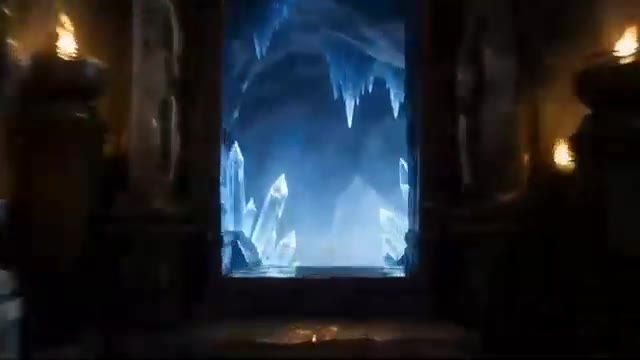
*Visuel de démonstration généré par IA montrant l'entrée d'une grotte mystérieuse avec des cristaux de glace bleus.*

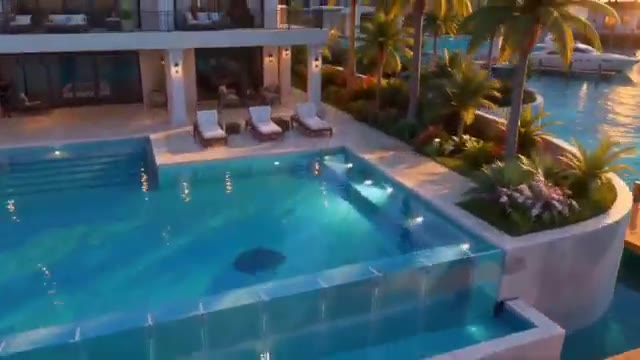
*Visuel de démonstration généré par IA représentant une luxueuse villa moderne au bord de l'eau avec piscine et palmiers.*

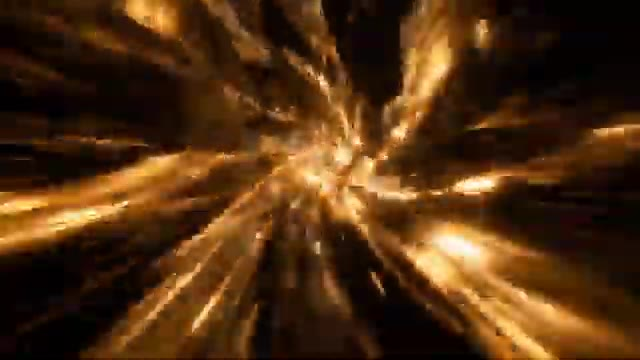
*Animation visuelle de transition abstraite et lumineuse avec des faisceaux dorés en mouvement rapide.*

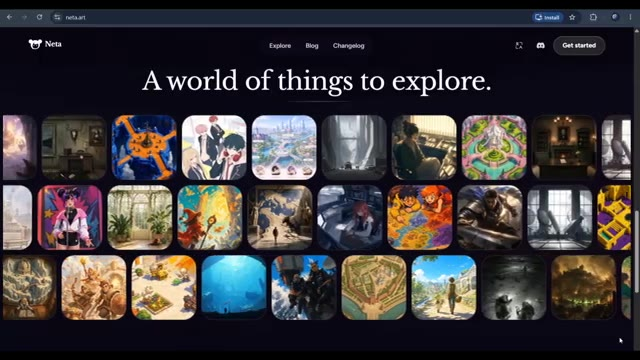
*Capture d'écran du site web de Netta Studio (neta.art) affichant la page d'accueil avec de multiples vignettes de mondes virtuels et le slogan « A world of things to explore ».*

---

### ⏱️ `[00:00:33 - 00:01:09]` | Segment #02

**🔊 Audio (Transcription Intégrale Mot pour Mot en Français) :**
> C'est Pursuing AI, et vous regardez le rapport de recherche. J'ai ouvert Netta Studio, et c'est la première chose que vous voyez. L'idée derrière tout ça est assez simple. Vous commencez avec une idée, puis vous construisez progressivement un monde entier autour d'elle. Au lieu de simplement générer une histoire ou une image, vous pouvez développer des personnages, des lieux, des factions et du lore, puis utiliser ces éléments pour développer encore plus votre monde. Et plutôt que de simplement regarder ce que d'autres ont créé, je voulais voir ce qui se passerait si je construisais mon propre monde à partir de zéro. Commençons donc. J'ai commencé par un concept simple, un jeu de crime en monde ouvert fictif inspiré par l'atmosphère de la Floride moderne.

**👁️ Analyse Visuelle d'Écran (gemini-3.5-flash-lite) :**
**Interface & Outils** : Netta Studio (netta.art) et interface de génération vidéo ou de création de mondes virtuels.

**Contenu textuel & Code** : URL de Netta Studio : netta.art/world/world_01M40... ; texte principal : "Coral Vice" et "Doraluna is a city that sells sunshine and forgives everything else..."; dans le panneau latéral : commandes textuelles ("Fan-Made GTA 6-Style Open-World Crime Ga...", "Load narrating-v2 skill", "Read world phase", etc.).

**Action / Démonstration** : Le créateur navigue à travers différentes interfaces de génération de mondes (vidéos cinématiques et plateforme Netta Studio).

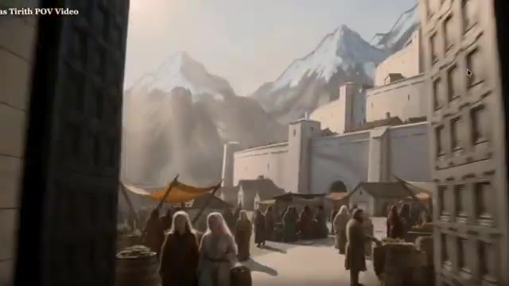
*Aperçu d'une vidéo générée montrant une rue animée de la cité de Minas Tirith avec des montagnes enneigées en arrière-plan.*

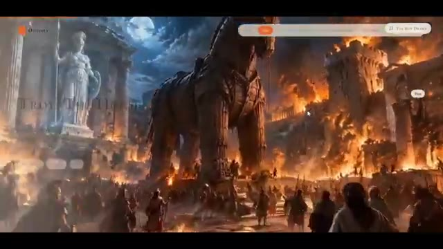
*Scène cinématique générée montrant le cheval de Troie devant des temples et des bâtiments en flammes sous la lune.*

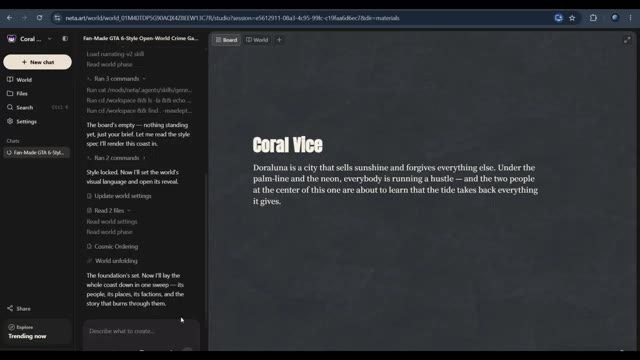
*Interface de Netta Studio (netta.art) affichant un panneau de discussion à gauche et le texte de présentation du monde 'Coral Vice' sur le tableau principal.*

---

### ⏱️ `[00:01:09 - 00:01:46]` | Segment #03

**🔊 Audio (Transcription Intégrale Mot pour Mot en Français) :**
> Nous avons nos personnages principaux, Ren et Diaz, ainsi que plusieurs personnages secondaires, et autour d'eux, Netta a commencé à construire les lieux. Nous avons des endroits comme Dora Luna, Cielo Beach, et plusieurs autres zones, mais un monde a besoin de plus que des personnages et des lieux. Il a besoin d'une histoire qui relie le tout. Netta a donc également développé des organisations criminelles, des forces de l'ordre, des factions rivales et les conflits entre elles. Elle a même commencé à relier ces éléments au scénario principal. Et après la génération initiale, nous avions 47 cartes représentant différentes parties de notre monde. Celles-ci comprenaient des personnages, des lieux, des factions, des entreprises,

**👁️ Analyse Visuelle d'Écran (gemini-3.5-flash-lite) :**
**Interface & Outils** : Application web Netta (neta.art) utilisée pour la génération et l'organisation d'univers de jeux de type GTA 6.

**Contenu textuel & Code** : Menus et cartes textuelles interactives représentant les personnages ('Ren', 'Diaz'), les lieux ('Dora Luna', 'Cielo Beach', 'Sabrocosta'), les factions et l'histoire en quatre actes, ainsi que le panneau latéral 'World Wiki' indiquant '47 entries'.

**Action / Démonstration** : Le créateur navigue à travers l'interface de l'application Netta pour montrer les différentes catégories de cartes générées (personnages, lieux, factions, histoire) qui constituent le monde virtuel.

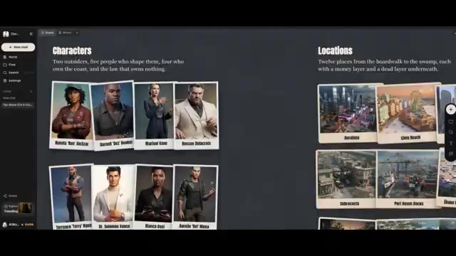
*Interface de Netta montrant la section 'Characters' avec des cartes de personnages comme Ren et Diaz.*

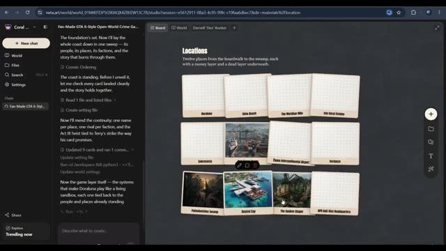
*Interface de Netta affichant la section 'Locations' avec des cartes de lieux comme Dora Luna et Cielo Beach.*

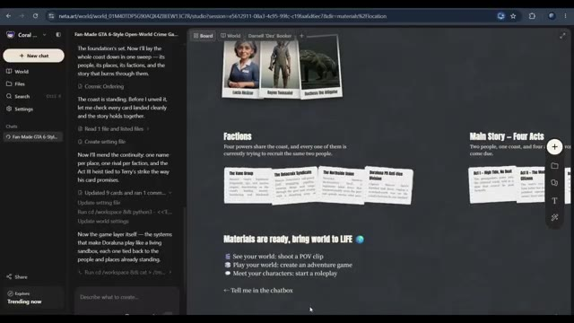
*Interface de Netta présentant la section 'Factions' et les options pour donner vie au monde.*

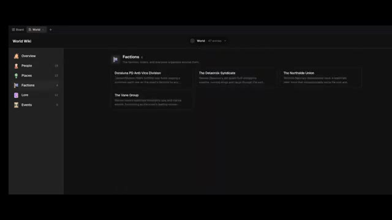
*Interface du 'World Wiki' de Netta montrant les 47 entrées réparties par catégories (People, Places, Factions, Lore, Events).*

---

### ⏱️ `[00:01:46 - 00:02:22]` | Segment #04

**🔊 Audio (Transcription Intégrale Mot pour Mot en Français) :**
> des missions, et d'autres éléments. Mais maintenant je voulais explorer quelque chose de plus intéressant. À quoi ressemble réellement ce monde lorsque nous rassemblons toutes ses pièces ? J'ai donc exploré ensuite la fonctionnalité de carte du monde de Netta. Au lieu de regarder les cartes de localisation individuelles une par une, je voulais voir le monde dans son ensemble. Et voilà. Maintenant, nous pouvons voir les différentes régions et emplacements disposés ensemble, ce qui nous donne une image beaucoup plus claire du monde que nous avons construit. C'est particulièrement utile pour un monde comme le nôtre, où nous avons de multiples emplacements, différents groupes, et une histoire qui les relie. Parce que lorsque vous créez un concept de monde ouvert, ce n'est pas seulement

**👁️ Analyse Visuelle d'Écran (gemini-3.5-flash-lite) :**
**Interface & Outils** : Application Netta Art (interface de création de monde ouvert / wiki / cartographie interactive).

**Contenu textuel & Code** : Textes visibles : 'World Wiki', 'Factions', 'Lore', 'Fan-Made GTA 6-Style Open-World Crime Game Concept', descriptions de factions (Doraluna PD Anti-Vice Division, The Delacroix Syndicate), et 'The Meridian Mile'.

**Action / Démonstration** : Le créateur navigue à travers les différentes sections du wiki du monde, puis présente la carte globale interactive et zoome sur un quartier spécifique.

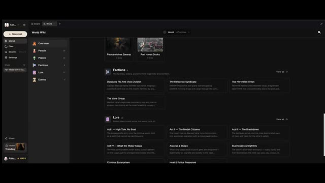
*Interface du wiki du monde montrant les rubriques Overview, People, Places, Factions, Lore et Events.*

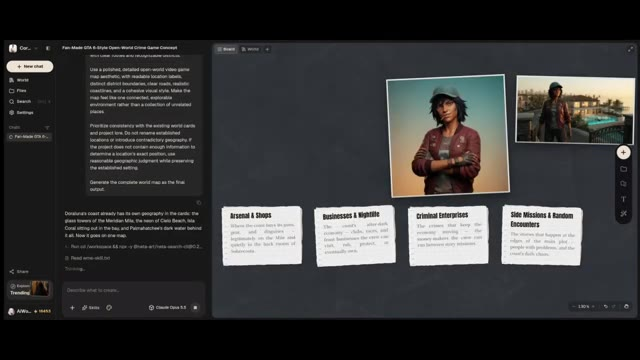
*Interface de Netta avec panneau de discussion à gauche et espace de travail visuel à droite affichant des fiches de concepts et des portraits.*

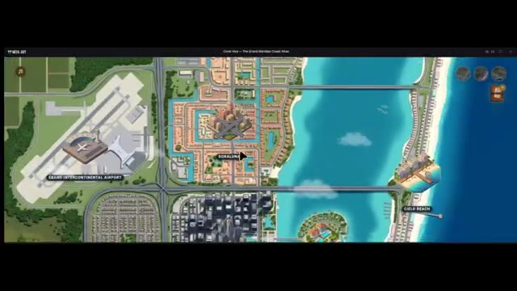
*Vue aérienne complète d'une carte du monde de style GTA montrant différentes zones géographiques interconnectées.*

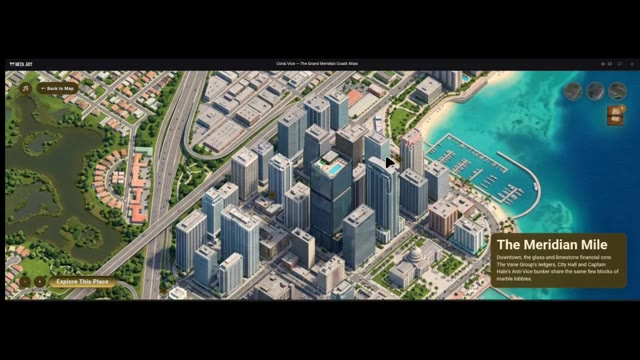
*Zoom détaillé sur une zone urbaine spécifique de la carte avec une description textuelle de 'The Meridian Mile'.*

---

### ⏱️ `[00:02:22 - 00:02:43]` | Segment #05

**🔊 Audio (Transcription Intégrale Mot pour Mot en Français) :**
> à propos d'inventer des endroits individuels. Il s'agit de comprendre comment ces endroits s'intègrent dans l'univers plus vaste. Et maintenant que nous avons une meilleure image de notre monde, je veux aller un peu plus loin. Et si nous pouvions réellement faire l'expérience de ce monde de l'intérieur ? C'est là que les choses deviennent particulièrement intéressantes. Jusqu'à présent, nous avons principalement observé notre monde de l'extérieur.

**👁️ Analyse Visuelle d'Écran (gemini-3.5-flash-lite) :**
**Interface & Outils** : Application web interactive de cartographie et d'exploration de monde virtuel (interface style atlas interactif avec zoom et points d'intérêt cliquables).

**Contenu textuel & Code** : Noms des lieux affichés : "Coral Vice - The Grand Meridian Coast Atlas", "The Meridian Mile", "Isla Coral Estates", "Eband Intercontinental Airport", "Doraluna", "Cielo Beach". Description textuelle d'Isla Coral Estates : "A gated island in the bay built on dredged fill, with villas, private docks and the coast's donor money..." Boutons interactifs comme "Back to Map" et "Explore This Place".

**Action / Démonstration** : Navigation et zoom à travers la carte interactive d'un monde virtuel pour explorer différents quartiers et lieux spécifiques.

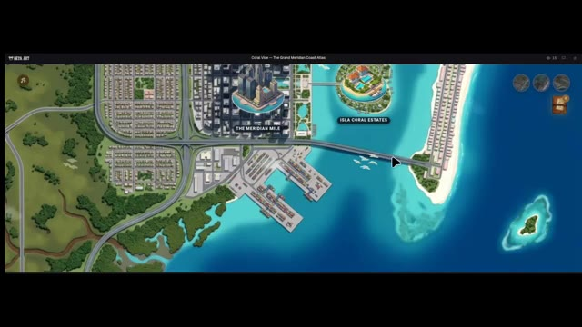
*Vue aérienne interactive de la carte d'une ville virtuelle nommée Coral Vice avec des zones comme The Meridian Mile et Isla Coral Estates.*

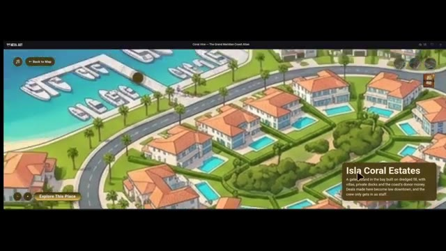
*Zoom sur le quartier résidentiel de luxe Isla Coral Estates montrant des villas avec piscines, des quais et une description textuelle.*

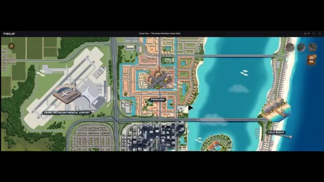
*Vue d'ensemble de la grande carte interactive montrant plusieurs zones de la ville, incluant un aéroport et différentes îles côtières.*

---

### ⏱️ `[00:02:43 - 00:03:05]` | Segment #06

**🔊 Audio (Transcription Intégrale Mot pour Mot en Français) :**
> Mais et si nous pouvions réellement nous y déplacer ? Je voulais voir si Netta pouvait créer une vidéo en vue subjective (POV) à la première personne qui nous plonge à l'intérieur du monde que nous avons construit. J'ai donc exploré le flux de travail de la vidéo POV et j'ai utilisé notre monde comme point de départ. Et maintenant, jetons un œil au résultat.

**👁️ Analyse Visuelle d'Écran (gemini-3.5-flash-lite) :**
**Interface & Outils** : Interface de type tableau de bord interactif combinant un assistant textuel et une vue de gestion de projet visuelle (Board/Canvas) avec des assets de personnages et de décors.

**Contenu textuel & Code** : Texte du prompt et de l'historique de chat visible sur l'interface (mentionnant "Fan-Made GTA 6-Style Open-World Game Concept", "Wrong Car, Right Night", "Next POV: The Knock") ainsi que des vignettes de personnages ("Characters") et de lieux ("Locations").

**Action / Démonstration** : Démonstration visuelle des rendus vidéo générés par l'IA et de l'interface de travail utilisée pour orchestrer le workflow de création du monde virtuel.

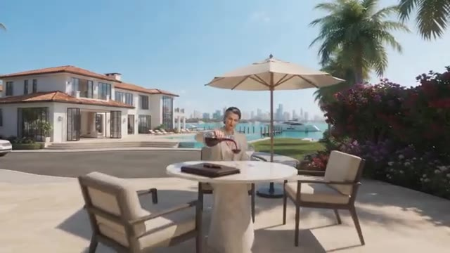
*Rendu vidéo généré par IA montrant une vue extérieure avec une villa de luxe au bord de l'eau et un personnage versant du vin.*

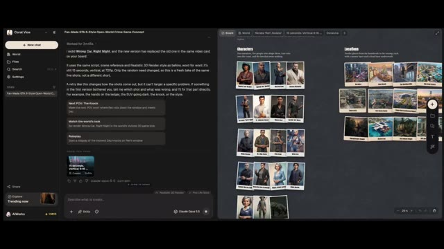
*Interface de gestion de projet (type tableau blanc et interface de chat style Claude) montrant des concepts de jeux de type GTA 6, des fiches de personnages et des localisations.*

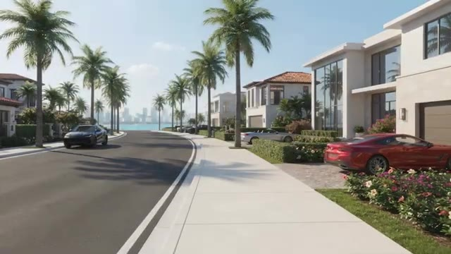
*Rendu vidéo en vue subjective (POV) montrant une rue résidentielle bordée de palmiers et de maisons luxueuses avec des voitures de sport garées.*

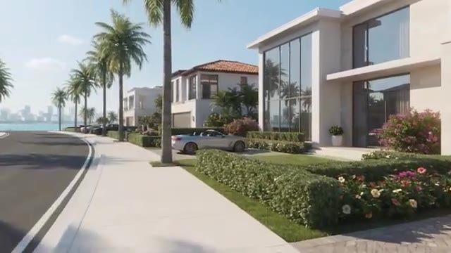
*Rendu vidéo en mouvement simulant une vue subjective (POV) longeant le trottoir d'un quartier résidentiel tropical haut de gamme.*

---

### ⏱️ `[00:03:05 - 00:03:25]` | Segment #07

**🔊 Audio (Transcription Intégrale Mot pour Mot en Français) :**
> Ensuite, je voulais explorer la génération de compétences WorldBox, et cela nous donne une autre façon d'explorer le processus de construction de monde à l'intérieur de Netta Studio. La partie intéressante de cette expérience est que nous ne traitons pas chaque création comme un projet complètement séparé. Nous continuons à travailler avec un monde que nous avons déjà établi, et c'est ce qui rend cela intéressant pour moi.

**👁️ Analyse Visuelle d'Écran (gemini-3.5-flash-lite) :**
**Interface & Outils** : Netta Studio (interface web interactive de création de mondes par IA).

**Contenu textuel & Code** : Menus de compétences ("Skills", "World Box"), panneau de discussion latéral, texte descriptif de l'univers "Characters" (Two outsiders, five people who shape them...), et rendu 3D cinématique d'une rue côtière.

**Action / Démonstration** : Navigation dans l'interface de Netta Studio pour sélectionner une compétence de génération ("WorldBox") et visualisation d'un rendu 3D du monde créé.

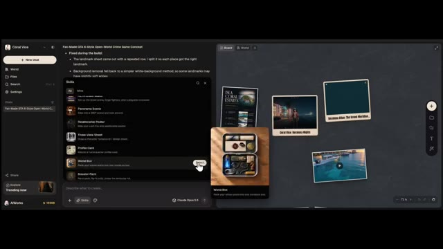
*Interface de Netta Studio montrant le menu des compétences avec l'option "WorldBox" sélectionnée.*

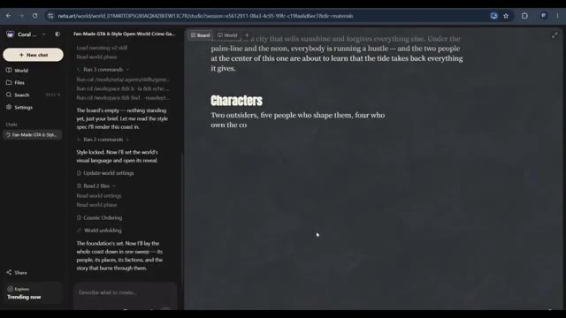
*Interface de Netta Studio affichant le panneau de discussion et le texte descriptif du monde "Characters".*

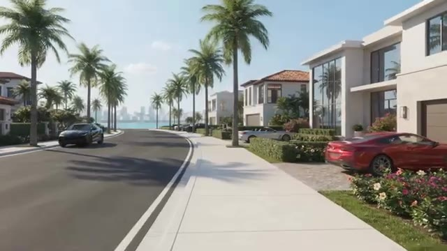
*Rendu visuel d'un quartier résidentiel ensoleillé bordé de palmiers dans un style de jeu vidéo en monde ouvert.*

---

### ⏱️ `[00:03:25 - 00:03:44]` | Segment #08

**🔊 Audio (Transcription Intégrale Mot pour Mot en Français) :**
> Ce n'est pas seulement générer une seule image ou écrire une histoire. Il s'agit de développer un monde et de trouver différentes façons de donner vie à ce monde. Bien sûr, les résultats dépendent de vos invites et de ce que vous essayez de créer, il y a donc toujours de la place pour expérimenter et affiner les choses. Mais si vous avez toujours voulu construire votre propre univers fictif, Netta Studio vaut le détour.

**👁️ Analyse Visuelle d'Écran (gemini-3.5-flash-lite) :**
**Interface & Outils** : Navigateur web affichant la plateforme Netta Studio (neta.art) ainsi que des clips vidéo de démonstration générés par IA.

**Contenu textuel & Code** : URL "neta.art", texte "A world of things to explore", menus de navigation (Explore, Blog, Changelog, Get started) et grille de nombreuses vignettes d'images et de mondes virtuels.

**Action / Démonstration** : Présentation visuelle d'un univers généré par IA avec un mouvement de caméra (travelling) dans un quartier résidentiel, suivie d'une transition montrant l'interface du site web Netta.art.

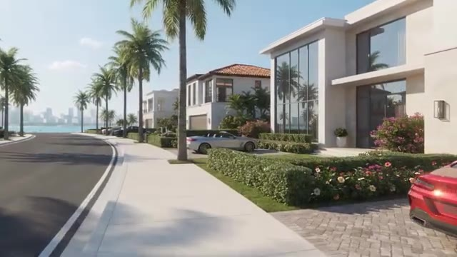
*Rendu visuel d'une rue résidentielle luxueuse en bord de mer généré par IA, montrant des villas modernes, des palmiers et des voitures de sport.*

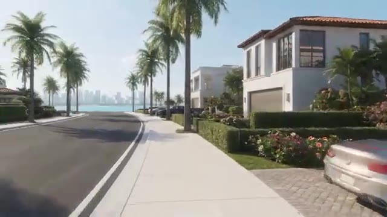
*Suite du rendu vidéo en travelling avant le long de la rue résidentielle côtière bordée de palmiers et de villas blanches.*

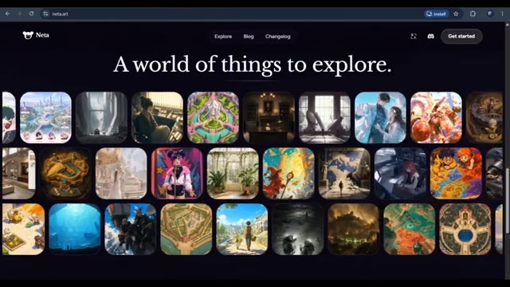
*Capture d'écran du site web de Netta Studio (neta.art) affichant la page d'accueil avec le slogan "A world of things to explore" et une grille de vignettes d'œuvres générées.*

---

### ⏱️ `[00:03:44 - 00:03:48]` | Segment #09

**🔊 Audio (Transcription Intégrale Mot pour Mot en Français) :**
> J'ai mis le lien dans la description, ainsi que le lien de la communauté Netta Studio.

**👁️ Analyse Visuelle d'Écran (gemini-3.5-flash-lite) :**
**Interface & Outils** : Navigateur web affichant le site web Netta Studio (neta.art).

**Contenu textuel & Code** : En-tête avec le logo "Neta", les onglets de navigation "Explore", "Blog", "Changelog", un bouton pour Discord et un bouton "Get started". Le slogan principal affiché au centre est "A world of things to explore." avec une grille d'illustrations artistiques et variées en dessous.

**Action / Démonstration** : Navigation et présentation de la page d'accueil de la plateforme Netta Studio sur le navigateur web.

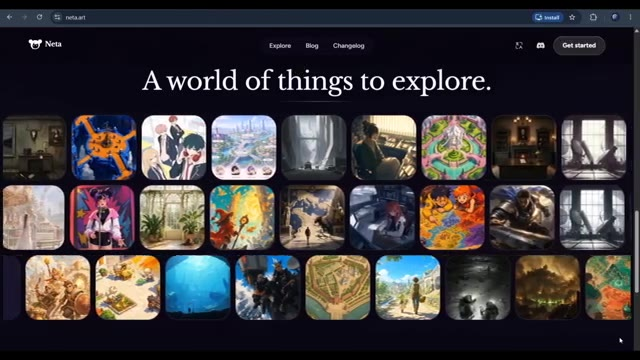
*Page d'accueil du site web Netta Studio (neta.art) montrant une galerie d'images et de créations artistiques générées par IA.*

---
