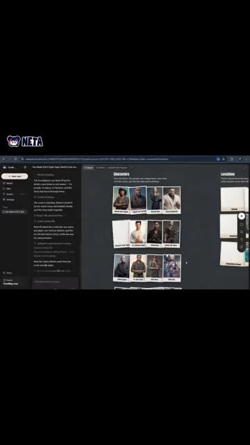
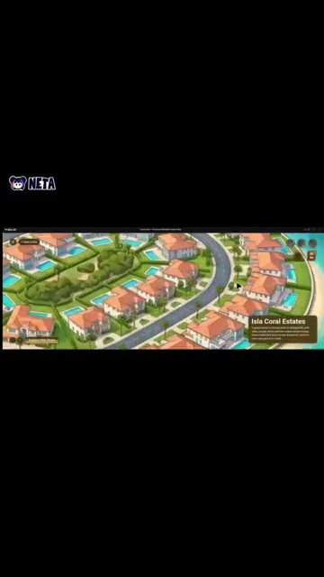
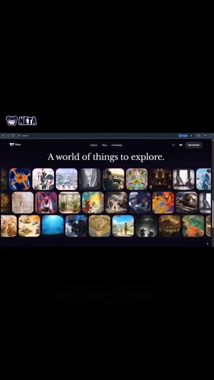

# 🎬 J'ai transformé mon imagination en monde IA 🤯

> **Chaîne** : [Pursuing AI](https://www.youtube.com/@PursuingAi)  
> **Titre original** : `I Turned My Imagination Into an AI World 🤯`  
> **Lien YouTube** : [https://www.youtube.com/watch?v=bklpylkskhU](https://www.youtube.com/watch?v=bklpylkskhU)  
> **Date de publication** : 2026-10-22  
> **Durée** : 00m 35s (`35s`)  
> **Identifiant vidéo** : `bklpylkskhU`  
> **Fiche Web Interactive** : [2026-10-22_YT-bklpylkskhU_J'ai transformé mon imagination en monde IA 🤯_by-whisper-v3-large-turbo+gemini-3.5-flash-lite.html](2026-10-22_YT-bklpylkskhU_J'ai transformé mon imagination en monde IA 🤯_by-whisper-v3-large-turbo+gemini-3.5-flash-lite.html)  
> **Captures de démonstration clés** : `3 captures réelles (anti-talking-head)`  
> **Modèles utilisés** : Audio: `large-v3-turbo` (Faster-Whisper int8 VPS) | Vision: `gemini-3.5-flash-lite` (Google AI Studio API)  

---

## 📌 Synthèse Exécutive & Outils

### 📌 Résumé
La vidéo « J'ai transformé mon imagination en monde IA » de Pursuing AI met en lumière une avancée majeure dans la création de contenus visuels par intelligence artificielle : le passage de la simple génération d'images isolées à la conception d'univers immersifs interconnectés. Le cœur de cette révolution repose sur **Netta Studio**, une plateforme novatrice qui permet aux créateurs de matérialiser instantanément une vision abstraite pour la transformer en un monde cohérent, peuplé de lieux singuliers et de personnages récurrents. Grâce à des outils de cartographie interactive, l'IA ne se contente plus d'illustrer un prompt, elle structure un territoire virtuel navigable.

La méthode présentée par le créateur s'articule autour d'un workflow fluide et itératif : partir d'une simple impulsion créative, générer des environnements visuels riches, puis utiliser la fonctionnalité **World Map** pour assembler ces décors et visualiser leur topographie globale. L'étape suivante — et la plus spectaculaire — consiste à injecter des mouvements de caméra en POV (point de vue à la première personne) pour simuler une exploration physique au cœur de l'œuvre. Des technologies complémentaires telles que **Seedance 2.5**, **Kling 3.0** et **Midjourney** interviennent en arrière-plan pour garantir une fidélité esthétique et une fluidité cinématique de haut niveau.

Pour les vidéastes, les réalisateurs et les créateurs de contenu, cette approche ouvre des perspectives inédites en matière de pré-visualisation, de world-building et de storytelling immersif. Il devient possible de concevoir des décors de films, des environnements de jeux vidéo ou des expériences interactives en un temps record, sans nécessiter de lourdes compétences en modélisation 3D ou en animation traditionnelle. L'imagination devient ainsi le seul frein, transformant chaque spectateur potentiel en explorateur d'un univers unique.

### 🛠️ Outils, Modèles & Logiciels Présentés
* **Netta Studio** : Plateforme centrale permettant de transformer une idée textuelle en un monde virtuel complet doté de lieux et de personnages uniques.
* **World Map (Netta Studio)** : Fonctionnalité intégrée servant à connecter et cartographier les différents environnements générés pour structurer un univers cohérent.
* **Seedance 2.5** : Modèle de pointe utilisé pour générer des dynamiques de mouvement fluides et des transitions cinématiques au sein des environnements virtuels.
* **Kling 3.0** : Outil de génération vidéo par IA mobilisé pour assurer le réalisme physique et la cohérence temporelle des séquences animées.
* **Midjourney** : Moteur de génération d'images par IA employé en amont pour concevoir les textures, les concepts art et l'esthétique visuelle de base des décors.
* **Génération Vidéo IA** : Ensemble des technologies de rendu dynamique permettant de produire les prises de vue en POV à la première personne.

### 🔑 Points Clés & Enseignements Stratégiques
* **Du concept à l'écosystème** : Ne pensez plus la création par IA comme une simple image isolée, mais comme un point de départ pour bâtir un écosystème visuel global et interconnecté.
* **Hiérarchisation par la World Map** : Utilisez des outils de cartographie visuelle pour organiser vos décors, ce qui garantit la cohérence spatiale de votre univers et évite l'effet de décors incohérents.
* **Immersion en POV** : Exploitez les prises de vue à la première personne (POV) pour transformer une observation passive en une véritable expérience sensorielle et interactive pour votre audience.
* **Synergie des moteurs** : Combinez la puissance textuelle et stylistique de Midjourney pour le design initial avec des modèles vidéo comme Kling 3.0 et Seedance 2.5 pour donner vie à l'animation.
* **Cohérence des personnages** : Veillez à injecter des descriptions récurrentes ou à utiliser des fonctionnalités de maintien d'identité pour que les personnages habitent naturellement ce nouveau monde.
* **Prototypage ultra-rapide** : Utilisez ce workflow pour valider des directions artistiques de films ou de jeux en quelques minutes, réduisant drastiquement les coûts de pré-production.
* **Rédaction de prompts spatiaux** : Dans vos instructions textuelles, privilégiez les descriptions topographiques (profondeur, arrière-plan, architecture) pour faciliter le travail ultérieur de mise en relation des lieux.
* **Gestion du rythme cinématique** : Lorsque vous simulez une marche en POV, veillez à paramétrer des mouvements de caméra stables pour éviter la nausée visuelle tout en conservant un dynamisme naturel.
* **Accessnalité du World-Building** : Ce type de technologie démocratise la création de mondes complexes, autrefois réservée aux studios dotés de budgets colossaux en effets spéciaux (VFX).
* **Piège à éviter (La dispersion)** : Ne générez pas des lieux au hasard ; définissez une thématique narrative centrale (cyberpunk, fantasy, post-apocalyptique) avant d'utiliser la World Map pour unifier le tout.
* **Exploitation marketing** : Partagez ces mondes explorables sous forme de teasers vidéo immersifs pour capter immédiatement l'attention sur les réseaux sociaux grâce à l'effet "Wouah".

---

## ⏱️ Chronologie & Transcription Complète Audio & Visuelle (Mot pour Mot)

### ⏱️ `[00:00:00 - 00:00:21]` | Segment #01

**🔊 Audio (Transcription Intégrale Mot pour Mot en Français) :**
> Et si vous pouviez transformer votre imagination en un monde entier et y marcher pour de vrai ? Voici Netta Studio. Partez simplement d'une idée et regardez-la se transformer en un monde rempli de lieux et de personnages uniques. Mais c'est là que ça devient intéressant. Avec World Map, vous pouvez rassembler vos lieux et voir comment votre monde se connecte. Et le plus cool dans tout ça ?

**👁️ Analyse Visuelle d'Écran (gemini-3.5-flash-lite) :**
**Interface & Outils** : Netta Studio (application web de génération de mondes virtuels par IA).

**Contenu textuel & Code** : On distingue une interface sombre avec un panneau latéral de chat textuel, un tableau central affichant des fiches de personnages sous l'onglet « Characters », et une vue de carte interactive (« World Map ») montrant un quartier résidentiel avec des maisons aux toits de tuiles oranges et des piscines, étiqueté « Isla Coral Estates ».

**Action / Démonstration** : Le curseur navigue dans l'interface de Netta Studio pour présenter la gestion des personnages et l'exploration de la carte du monde.

*Interface de Netta Studio montrant le tableau des personnages et des lieux générés.*

*Vue aérienne interactive de World Map montrant le lotissement résidentiel d'Isla Coral Estates.*

---

### ⏱️ `[00:00:21 - 00:00:34]` | Segment #02

**🔊 Audio (Transcription Intégrale Mot pour Mot en Français) :**
> Vous pouvez générer des vidéos en POV à la première personne et vivre votre création comme si vous y marchiez réellement. Votre imagination devient un monde que vous pouvez explorer et partager. Vous voulez construire le vôtre ? Découvrez Netta Studio sur netta.art.

**👁️ Analyse Visuelle d'Écran (gemini-3.5-flash-lite) :**
**Interface & Outils** : Navigateur web affichant le site officiel de Netta Studio (netta.art) avec une interface d'exploration visuelle sous forme de galerie de vignettes.

**Contenu textuel & Code** : Texte principal visible : "A world of things to explore.", menu de navigation en haut ("Explore", "Blog", "Changelog") et boutons de connexion/démarrage ("Get started"). Grille de nombreuses vignettes miniatures représentant divers environnements et mondes virtuels générés. Logo "NETTA" visible dans le coin supérieur gauche.

**Action / Démonstration** : Navigation sur le site web de Netta Studio montrant la galerie des mondes disponibles à l'exploration.

*Capture d'écran du site web de Netta Studio (netta.art) affichant une grille d'exploration de mondes virtuels et de créations artistiques.*

---
